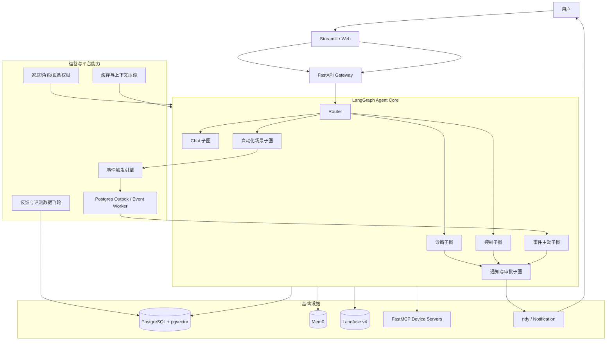
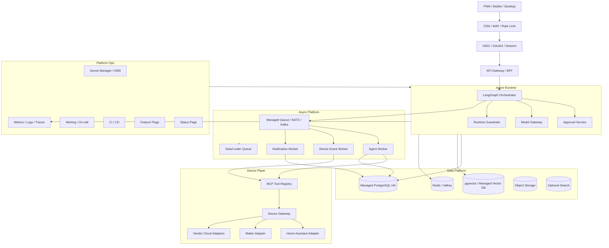

# HomePilot-Agent —— 会追问的智能设备家庭助手 Agent

> **一句话定位：** 一个基于 Python 的智能设备家庭助手 Agent。它围绕“家庭空间 + 家庭成员 + 智能设备 + 生活任务”理解自然语言，能查设备、诊断故障、审批控制、编排场景、管理提醒、记住偏好、检索设备知识，并逐步演进为可主动服务的家庭运营系统。

| 项目 | 说明 |
|---|---|
| 文档版本 | **v1.2** |
| 更新日期 | 2026-10-23 |
| 项目形态 | 本地优先可运行 Web 应用 + 模拟 / 真实设备 MCP Server |
| 主要用途 | Agent 技术学习、真实项目迭代、面试展示；按第七部分补齐后可作为私有部署 / 小规模商用产品方案 |
| 领域定位 | 智能设备家庭助手：家庭空间、家庭成员、设备控制、场景自动化、主动提醒、故障诊断、能耗与安全 |
| 核心原则 | 90% 精力投入 Agent 逻辑；核心闭环按真实产品标准，外围产品工程只做到“能演示”；每个简历数字都能被 repo 测试复现 |

## 📌 阅读导航

| 部分 | 内容 |
|---|---|
| 第一部分 | 产品定义：家庭助手定位、核心功能、能力模型、边界 |
| 第二部分 | 技术方案：架构、LangGraph、记忆、RAG、MCP |
| 第三部分 | 评估与可观测：pytest、LLM-as-Judge、CI、Langfuse |
| 第四部分 | 工程计划：技术栈、10 周路线、学习指南、风险 |
| 第五部分 | 功能扩展计划：EP0 / EP1 / EP2 / Future 分层路线 |
| 第六部分 | 求职包装：README、ADR、简历写法、面试脚本 |
| 第七部分 | 可上线产品化审查：GA 标准、生产架构、差距清单、发布路线 |
| 配套文档 | `HomePilot-Agent-开发环境与工具清单-v1.0.md`：开发环境、依赖、配置、IDE 插件、CI 和分阶段工具 |
| 附录 | 面试前自查清单、AI 协作开发约定 |

## 🧭 v1.1 变更摘要

| 变更 | 说明 |
|---|---|
| 合入功能扩展计划 | 原独立扩展计划并入主文档，形成统一项目蓝图 |
| 新增 EP0 能力 | 自动化编排、事件驱动主动 Agent、通知与远程审批 |
| 新增 EP1 能力 | 家庭权限、用户反馈数据飞轮、上下文压缩与缓存 |
| 明确后续接入项 | 语音、视觉、Matter、能耗优化、开放平台暂缓接入 |
| 统一技术口径 | Python 3.14 / LangGraph 1.2.x / FastMCP 4.x / PostgreSQL 18 / Langfuse v4 |

## 🔧 v1.1-r1 优化说明

| # | 优化点 | 说明 |
|---|---|---|
| 1 | 项目定位从“只求面试”调整为“学习面试 + 真实产品标准” | 核心能力不阉割，项目可自用、后续可迭代，避免只剩 demo 表象 |
| 2 | 新增数据来源与演示数据口径 | 明确模拟 MCP、合成事件、对话记录、未来 Home Assistant / Matter 适配层，避免真实数据与演示数据混谈 |
| 3 | 新增产品成功标准 | 面试指标、可复现指标、自用指标分层，保证“可演示、可运行、可迭代” |
| 4 | 补强安全边界的确定性分层 | 风险阻断 / 审批是硬边界；诊断解释和通知话术是软边界；LLM 只做转写，不做安全裁决 |
| 5 | 细化候选故障假设计算 | 用证据反查 + 并集 + 命中证据数排序，避免严格交集塌空，也让“候选集收缩”可评估 |
| 6 | 统一会话 / 情景记忆范围 | 不只诊断子图有记忆，chat / 巡检 / 控制 / 自动化 / 事件主动服务都写入统一上下文 |
| 7 | 增加统一评估 harness | 确定性评估和语义评估共用入口，后续子图、自动化、事件主动服务复用同一套结果口径 |
| 8 | 工程地基前置 Alembic | 第 1 周就具备可迁移 schema，避免后期手工改表 |
| 9 | 主动服务明确独立 worker | 事件触发与通知不在请求进程内跑，避免 Web 进程重启后任务丢失 |
| 10 | 新增 AI 协作开发约定 | 每步先概念、再计划、再实现；完成后 commit、复述、说明改动原因 |

## 🧪 v1.1-r2 可上线审查结论

**结论：当前方案不是 demo 级一次性项目，但也不能直接宣布为“可上线标准产品方案”。**  
它已经具备产品化的正确骨架：领域模型、Agent 状态机、MCP 工具边界、审批门控、评估体系、审计链、记忆体系、扩展路线都存在。  
但从公开商用 GA 视角看，还需要补齐身份认证、多租户隔离、真实设备适配、生产部署、SLO、备份恢复、合规、客服与事故响应等平台化能力。

**更准确的分级结论：**

| 阶段 | 判定 |
|---|---|
| 当前 10 周核心方案 | 可本地部署的个人学习 / 面试展示系统，不是公网 GA |
| 完成 EP0 后 | 具备私有部署单家庭产品的雏形 |
| 完成 EP1 后 | 可进入多家庭成员 private beta |
| 完成第七部分生产化清单后 | 才能作为可上线标准产品方案评审 |

## 🏠 v1.2 家庭助手定位升级摘要

| # | 升级点 | 说明 |
|---|---|---|
| 1 | 从“设备管家”升级为“家庭助手” | 不只管理设备，而是服务家庭成员在“安全、舒适、节能、省心”上的目标 |
| 2 | 引入家庭空间模型 | 以 home / zone / room / device / member / pet / policy 组织上下文 |
| 3 | 引入家庭模式与在场状态 | 支持在家、离家、夜间、睡眠、度假、访客、老人照护等模式 |
| 4 | 引入生活任务层 | 天气、时间、提醒、待办、作息、家庭公告作为设备决策与主动服务的上下文 |
| 5 | 引入统一设备能力模型 | 将异构设备抽象为 canonical capabilities，避免 Agent 只认识零散工具 |
| 6 | 引入家庭策略引擎 | 家庭策略、成员权限、隐私边界、设备安全边界与 Agent 决策分层 |
| 7 | 补充可上线的家庭助手能力路线 | MVP 先做空间 / 场景 / 提醒，Private Beta 补成员 / 权限 / 在场，GA 前补能耗 / 语音 / 多模态 |

## 🗂️ v1.0 设计要点回顾

| # | 变更 | 理由 |
|---|---|---|
| 1 | 可观测 Langfuse + OTel 前置到第 1 周 | 先有 trace 再写逻辑，调试效率更高 |
| 2 | 设备接入层采用 MCP 动态工具发现 | 新增设备类型不改 Agent 核心代码 |
| 3 | 危险操作审批门控作为 P0 | 设备控制不能黑盒下发 |
| 4 | 10 周计划，核心闭环第 5 周完成 | 保证最低可交付、可面试 |
| 5 | 状态 schema 与子图注册解耦 | 新能力以子图挂载，不重写主流程 |
| 6 | 模型适配层配置驱动 + fallback | 换模型主要改 yaml，不侵入核心 |
| 7 | 记忆层短期 / 长期接口分离 | Mem0 起步，图记忆预留 |
| 8 | 设备控制按安全关键路径设计 | 风险等级 + 审批门控 + 审计链 |
| 9 | 简历数字全部带测试口径 | 避免面试被反问时无法复现 |
| 10 | 求职包装纳入工程计划 | README、ADR、面试脚本同步准备 |

---

# 第一部分：产品定义

## 一、项目定位

HomePilot-Agent 是一个面向真实家庭的**智能设备家庭助手**。它不是通用聊天机器人，也不是只会调用设备 API 的遥控器，而是围绕一个家庭的**空间、成员、设备、习惯、任务和安全策略**提供持续服务。Agent 应该能理解“客厅太暗”“我快到家了”“老人房间温度太低”“离家前检查一遍”“孩子不能开门锁”这类目标背后的家庭语义。

项目定位是**学习面试 + 真实产品标准**：短期不追求上架和外部规模运营，但核心能力不阉割——诊断、审批、记忆、事件驱动、家庭上下文、审计和评估都按可长期迭代的口径实现，目标是**既能支撑 30 分钟面试，全家日常也愿意用**。

产品形态是本地运行的 Web 应用（Streamlit），设备数据通过**模拟设备 MCP Server** 提供（未来可替换为真实 Home Assistant / Matter / HealthKit 适配器）。用户在对话界面用自然语言下达设备请求，Agent 完成状态查询、异常诊断、控制执行和主动提醒的全流程。

**领域背景是你的隐性优势**：如果你有 IoT / 智能家居 / 设备运维相关经验，面试时这个项目不需要包装成"智能家居创新"，而是包装成"一个懂设备领域的开发者，用 Agent 技术栈把设备管理工程化了"。

### 数据来源与演示口径

| 来源 | 用途 | 实现方式 | 数据口径 |
|---|---|---|---|
| 模拟设备 MCP Server | 设备状态、属性、控制反馈 | FastMCP 暴露灯光、空调、传感器、网关等工具 | 合成演示数据，明确标注 `synthetic` |
| 设备事件种子集 | 离线、低电量、异常状态、主动诊断演示 | seed 脚本或 MCP `import_device_snapshot` 构造 | 预置 30-120 天事件窗口，便于巡检和趋势演示 |
| 对话记录 | 用户别名、偏好、确认、拒绝、修正 | chat 子图工具调用写入偏好与情景记忆 | 真实交互数据，但仅本地个人使用 |
| CSV / JSON 批量导入 | 设备拓扑、历史事件、能耗数据 | pandas 校验后经 MCP 写入 | 用 `source_type=synthetic/manual/import` 区分 |
| Home Assistant / Matter / 厂商云 | 后续真实设备接入 | 新增对应 MCP Server，不改 Agent 核心编排 | MVP 不接，只保留工具签名和权限边界 |

所有主动诊断、能耗趋势、预测维护示例都必须能追溯 `device_id`、事件时间、数据来源和 `synthetic` 标记；面试时不把演示数据说成真实长期数据。

### 成功标准

| 类别 | 标准 |
|---|---|
| 面试演示 | 30 秒内完成“模糊描述 → 假设排查 → 风险分级 → 审批执行”主链路 |
| 可复现 | README 一条命令启动；陌生人可跑通种子数据 + 诊断 + 审批演示 |
| 可观测 | Langfuse 能打开完整 trace：路由、MCP 工具调用、状态转移、token 成本、降级标签、审批事件 |
| 可评估 | pytest 红线用例失败能阻断 CI；每个简历数字能定位到测试文件或 golden 数据集 |
| 可扩展 | 现场演示新增空调域 MCP Server 后，Agent 核心代码零修改即可调用 |
| 自用价值 | 家庭成员能记录设备别名 / 偏好，能收到离线、低电量、模式冲突、维护周期等主动提醒，拒绝后不重复打扰 |
| 持续迭代 | 自动化、权限、反馈数据飞轮按 EP0 / EP1 / EP2 路线继续演进 |

## 二、核心功能

### 功能一：设备状态巡检与异常汇总（核心）

用户输入"帮我看看家里设备都正常吗"，Agent 不逐条罗列，而是**并行查询多设备状态 → 汇总异常项 → 主动给出处理建议**。

示例输出：

> "检查了 8 台设备：6 台正常，2 台异常。
> ① 卧室温湿度传感器电量 8%，预计 2 天后离线，需要我提醒你购买电池吗？
> ② 客厅灯处于离线状态，上次在线是 3 小时前，可能网络波动，需要我尝试重连吗？"

### 功能二：故障诊断与处理（核心）

用户说"客厅灯不亮了"，Agent **不是直接开灯**，而是像运维工程师一样**逐层排查**：

1. 查设备状态（是否离线 / 是否开关关闭 / 是否亮度为 0）
2. 查最近事件（是否有人手动关过 / 是否定时任务触发）
3. 查关联设备（网关是否在线 / 同房间其他设备是否正常）
4. 给出诊断结论 + 建议动作 → 用户确认 → 执行

示例输出：

> "客厅灯处于关闭状态，上次操作是 2 小时前通过墙壁开关关闭。同房间其他设备在线正常，网关无异常。诊断结论：设备本身正常，是人为关闭。需要我用 App 帮你打开吗？"

### 功能三：多设备批量控制与审批门控（核心）

用户说"把家里所有设备都重启一下"，Agent 识别为**高风险批量操作**，进入审批门控：

> "将重启 5 台设备，其中包含正在运行的冰箱和 NAS。确认执行？"
> [确认] [取消]

低风险操作（开灯、调亮度、查询状态）直接执行；中风险（重启单设备、修改定时任务）提示后执行；高风险（批量重启、恢复出厂、关闭总电源）强制审批。

### 功能四：跨会话偏好记忆

用户上周说过"我喜欢空调 26 度，别调太低"。本周用户说"有点热"，Agent 检索偏好记忆：

> "根据你的习惯，我把客厅空调调到 26 度。需要更低吗？"

### 功能五：设备接入与动态发现（扩展性核心）

Agent 通过 MCP 协议从设备 MCP Server **动态拉取可用工具列表**。新增设备类型（如从"灯光控制"扩展到"空调控制"）只需在 MCP Server 端注册新 `@mcp.tool`，**Agent 代码零修改**。

面试演示：现场往 MCP Server 加一个"加湿器控制"工具 → 重启 Server → Agent 自动感知并可使用，全程不改 Agent 代码。

### 功能六：设备能耗分析（子图挂载示例）

新增"能耗分析"能力以 **LangGraph 子图**形式挂载，主图通过条件边路由进入，不需要改主流程路由逻辑。这是"状态 schema 与子图注册解耦"的实证。

### 功能七：家庭模式与场景切换（家庭助手核心）

用户说“我出门了”“我快到家了”“准备睡觉”“来客人了”，Agent 不应只控制单台设备，而应执行一次受控的家庭模式迁移：

```text
识别目标模式
  → 加载家庭策略
  → 生成设备状态变化计划
  → 检查冲突与例外
  → dry-run
  → 低风险自动执行 / 高风险审批
  → 执行并回读状态
  → 汇报未完成项
```

示例：

> “我出门了。”  
> “已进入离家模式：关闭 12 台非安防设备，保留网关、摄像头和门锁；客厅窗户传感器显示打开，已暂停空调关闭动作，需要你确认。机器人将继续扫地。”

### 功能八：家庭提醒、作息与生活任务上下文（家庭助手核心）

设备 Agent 不应只做设备问答，还应理解家庭成员的生活任务：

| 能力 | 示例 |
|---|---|
| 天气上下文 | “今天有雨，回家模式提前打开除湿，阳台窗提示关闭。” |
| 时间与作息 | “工作日 22:30 进入儿童睡眠准备，关闭客厅电视，保留走廊夜灯。” |
| 提醒与待办 | “滤网每 90 天提醒一次；净水器滤芯预计 20 天后更换。” |
| 家庭公告 | “今晚会停电，冰箱门不要频繁打开，网关将切换到 UPS。” |
| 主动日报 | “昨晚客厅空调运行 7 小时，湿度一直偏高，建议检查除湿设置。” |

这些能力不把产品做成通用生活助理，而是让天气、时间、日程、提醒成为设备决策和主动服务的上下文。

## 二A、家庭助手能力模型

### 2A.1 分层模型

```text
L4 家庭目标层
    安全、舒适、节能、照护、省心

L3 家庭上下文层
    家庭模式、成员在场、作息、天气、提醒、访客、宠物、老人儿童

L2 家庭资产层
    home / zone / room / device / member / pet / policy / automation / service

L1 设备能力层
    power、brightness、color、temperature、humidity、lock、camera、motion、battery、media、irrigation

L0 协议适配层
    MCP / Home Assistant / Matter / Zigbee / 厂商云 / 本地 LAN 设备
```

Agent 决策不应直接从“用户一句话”跳到“调用某个工具”，而应先落到家庭上下文和设备能力模型，再生成受控计划。

### 2A.2 必须补充的核心能力

| 能力 | 说明 | 优先级 |
|---|---|---|
| 家庭空间模型 | `home_id`、`zone`、`room`、设备归属、公共 / 私有区域、室外区域 | P0 |
| 设备能力模型 | 将异构设备抽象成 canonical capabilities 和 constraints，而不是只依赖工具名 | P0 |
| 家庭模式 | 在家、离家、夜间、睡眠、观影、访客、度假、老人照护、儿童学习 | P0 |
| 场景编排 | 自然语言生成场景计划、dry-run、冲突检测、审批、执行、回读、回滚 | P0 |
| 成员在场 | 手动状态、手机连接、门锁事件、传感器、Wi-Fi / 蓝牙信号、地理围栏 | P1 |
| 作息与提醒 | 重复任务、滤芯更换、窗帘开合、浇水、电费峰谷、睡眠准备 | P1 |
| 生活上下文 | 天气、日出日落、节假日、日历事件、空气质量、电价 | P1 |
| 家庭成员画像 | 每个人的温度偏好、亮度偏好、过敏原、作息、无障碍需求 | P1 |
| 隐私与安全策略 | 摄像头、麦克风、门锁、定位、儿童、访客、外部模型的允许边界 | P1 |
| 家庭状态一致性 | expected state、actual state、pending state、failed state、last confirmed at | P0 |
| 家庭策略引擎 | 模式迁移、房间规则、成员权限、隐私策略、安静时间、节能策略 | P1 |
| 主动家庭摘要 | 早晨 / 离家 / 回家 / 睡前 / 周报 / 异常汇总 | P1 |
| 语音与多模态 | push-to-talk、语音打断、图像确认、摄像头异常识别 | P2 / Future |
| 能耗优化 | 分时段设备建议、高耗电设备排行、光伏 / 储能后续扩展 | P2 / Future |

### 2A.3 家庭模式状态机

```python
class HomeModeState(TypedDict):
    home_id: str
    current_mode: Literal[
        "unknown", "home", "away", "night", "sleep",
        "guest", "vacation", "elder_care", "child_study"
    ]
    target_mode: str | None
    trigger_source: Literal["user", "presence", "schedule", "sensor", "automation"]
    member_states: list[dict]
    planned_changes: list[dict]
    blocked_changes: list[dict]
    approval_required: bool
    execution_result: list[dict]
    unresolved_devices: list[dict]
    rollback_plan: dict | None
```

模式切换不是简单批量控制，而是一次策略执行：

```text
目标模式
  → 加载 home policy
  → 计算目标设备状态
  → 比较当前状态与期望状态
  → 标记冲突、例外、离线设备、私有区域限制
  → dry-run
  → 按风险分级执行
  → 状态回读
  → 输出已完成、失败、待确认项
```

### 2A.4 设备能力模型示例

```python
class DeviceCapability(BaseModel):
    capability: Literal[
        "power", "brightness", "color", "temperature", "fan_speed",
        "humidity", "lock", "camera_stream", "motion_detect",
        "battery", "media_play", "irrigation", "curtain", "energy_meter"
    ]
    supported: bool
    writable: bool
    readable: bool
    min_value: float | None = None
    max_value: float | None = None
    enum_values: list[str] | None = None
    unit: str | None = None
    risk_level: Literal["low", "medium", "high"] = "low"
    require_presence: bool = False
    require_approval: bool = False
    allow_in_sleep_mode: bool = True
```

这样 Agent 能理解“调暗一点”在不同设备上的合法映射：

| 用户表达 | 设备能力 | 控制动作 |
|---|---|---|
| “客厅调暗一点” | `brightness` | 当前亮度 - 20%，不低于 5% |
| “太冷了” | `temperature` | 空调目标温度 +1°C |
| “把门锁上” | `lock` | high risk，按家庭策略可能需要审批 |
| “看看门口” | `camera_stream` | 只返回授权家庭成员可访问的流，不保存截图 |
| “给花浇水” | `irrigation` | 限量执行，检测雨天可建议跳过 |

### 2A.5 家庭上下文数据模型

```sql
CREATE TABLE home_areas (
    id UUID PRIMARY KEY,
    home_id UUID NOT NULL,
    area_type VARCHAR(20) NOT NULL,   -- zone / room / outdoor
    name VARCHAR(100) NOT NULL,
    privacy_level VARCHAR(20) NOT NULL DEFAULT 'normal',
    UNIQUE (home_id, name)
);

CREATE TABLE home_members (
    id UUID PRIMARY KEY,
    home_id UUID NOT NULL,
    user_id UUID NOT NULL,
    display_name VARCHAR(100) NOT NULL,
    member_type VARCHAR(20) NOT NULL, -- adult / child / elder / guest / pet
    sleep_schedule JSONB,
    preferences JSONB,
    accessibility_needs JSONB,
    created_at TIMESTAMPTZ NOT NULL DEFAULT now(),
    UNIQUE (home_id, user_id)
);

CREATE TABLE home_modes (
    id UUID PRIMARY KEY,
    home_id UUID NOT NULL,
    mode VARCHAR(50) NOT NULL,
    state JSONB NOT NULL,
    reason TEXT,
    started_at TIMESTAMPTZ NOT NULL DEFAULT now(),
    ended_at TIMESTAMPTZ
);

CREATE TABLE presence_events (
    id BIGSERIAL PRIMARY KEY,
    home_id UUID NOT NULL,
    member_id UUID,
    source VARCHAR(50) NOT NULL,      -- manual / door_lock / sensor / wifi / geofence
    state VARCHAR(30) NOT NULL,       -- home / away / arriving / leaving / sleeping
    confidence DECIMAL(4,3),
    occurred_at TIMESTAMPTZ NOT NULL
);

CREATE TABLE home_tasks (
    id UUID PRIMARY KEY,
    home_id UUID NOT NULL,
    task_type VARCHAR(50) NOT NULL,   -- reminder / maintenance / routine / announcement
    title VARCHAR(200) NOT NULL,
    due_at TIMESTAMPTZ,
    repeat_rule VARCHAR(100),
    target_member_ids UUID[],
    related_device_id UUID,
    payload JSONB,
    status VARCHAR(20) NOT NULL DEFAULT 'pending'
);
```

### 2A.6 家庭助手成功标准

| 类别 | 标准 |
|---|---|
| 家庭语义 | 能把“我出门了 / 准备睡觉 / 客厅太暗 / 老人房间太冷”映射到空间、成员、模式和设备能力 |
| 场景执行 | 模式迁移支持 dry-run、冲突提示、审批、状态回读和失败汇总 |
| 家庭成员 | 支持成员、作息、偏好、临时访客、儿童和老人策略 |
| 生活任务 | 天气、时间、提醒、维护周期、主动日报可作为设备决策上下文 |
| 安全边界 | 门锁、摄像头、安防模式、儿童相关操作必须走家庭策略和审批门控 |
| 隐私边界 | 摄像头、麦克风、定位、私有房间数据有明确允许范围 |
| 可恢复 | 模式切换失败时能输出未完成项并给出回滚计划 |

## 三、明确不做的事

| 不做                                           | 原因                                                         |
| :--------------------------------------------- | :----------------------------------------------------------- |
| 真实设备接入（Home Assistant / Matter 全协议） | 需要真机调试；**但通过 MCP 预留适配层**（见技术方案第 11 节） |
| 移动端 App / 小程序                            | 开发周期长，对 Agent 学习零贡献                              |
| 真实用户获取                                   | 不做外部运营；但本人自用和真实产品标准是目标                 |
| 主动推送 / 定时周报（v1.0 核心闭环）           | 核心闭环先收敛；EP0 再引入事件驱动通知与远程审批             |
| 多用户 / 权限系统（v1.0 核心闭环）             | 单用户先跑通；EP1 再引入家庭、角色和设备级权限               |
| 语音交互 / 多模态                              | 与 Agent 编排学习目标无关                                    |
| 模型微调                                       | RAG + 工具调用已满足需求，微调是另一个技能树                 |
| 复杂前端（Next.js / 组件库）                   | Streamlit 半天搭出对话界面，前端不是学习目标                 |
| 通用生活问答助手                               | 不做开放域闲聊和百科问答；天气 / 时间 / 日程只作为家庭决策上下文 |
| 无边界健康 / 法律 / 金融建议                   | 家庭助手只处理设备、环境、安全、节能和生活提醒，不输出专业建议 |

# 第二部分：技术方案

## 四、总体架构

text

```
┌─────────────────────────────────────────────┐
│              Streamlit UI                    │
│   对话界面 + 设备状态侧栏 + 执行轨迹 + 审批弹窗 │
└─────────────────────┬───────────────────────┘
                      │ HTTP + SSE（st.write_stream 消费流）
┌─────────────────────▼───────────────────────┐
│              FastAPI 网关层                   │
│      请求路由 / SSE 流式推送 / 会话管理        │
└─────────────────────┬───────────────────────┘
                      │
┌─────────────────────▼───────────────────────┐
│         LangGraph Agent 编排层               │
│                                             │
│  ┌──────────────────────────────┐           │
│  │ Home Context Resolver         │           │
│  │ 家庭/房间/成员/模式/天气/作息   │           │
│  └──────────────────────────────┘           │
│                                             │
│  ┌──────────┐    ┌──────────────────────┐  │
│  │ Router   │───→│ 巡检子图              │  │
│  │ (意图分类)│    │ (Inspect SubGraph)   │  │
│  └──────────┘    └──────────────────────┘  │
│       │          ┌──────────────────────┐  │
│       ├──→       │ 诊断子图              │  │
│       │          │ (Diagnose SubGraph)  │  │
│       │          └──────────────────────┘  │
│       ├──→       ┌──────────────────────┐  │
│       │          │ 控制子图 + 审批门控    │  │
│       │          │ (Control + Approval) │  │
│       │          └──────────────────────┘  │
│       ├──→       ┌──────────────────────┐  │
│       │          │ 家庭模式子图           │  │
│       │          │ (Home Mode SubGraph) │  │
│       │          └──────────────────────┘  │
│       └──→       ┌──────────────────────┐  │
│                  │ chat 子图 + 记录工具   │  │
│                  └──────────────────────┘  │
│       ┌──────────────────────────────┐     │
│       │ 能耗分析子图（按需挂载示例）   │     │
│       └──────────────────────────────┘     │
└────────┬──────────────┬────────────────────┘
         │              │
┌────────▼──────────────▼────────────────────┐
│          数据与记忆层                        │
│  PostgreSQL(家庭/成员/设备/事件/偏好/RAG)     │
│  + LangGraph Postgres checkpointer(断点续跑) │
│  Mem0(长期偏好，可插拔)                      │
└─────────────────────┬──────────────────────┘
                      │ MCP 协议（FastMCP server）
┌─────────────────────▼───────────────────────┐
│     MCP 设备服务层（可独立演进，动态发现）      │
│  灯光Server / 空调Server / 传感器Server       │
│  tools/list 动态发现 · 工具 risk_level 标注  │
└─────────────────────────────────────────────┘
```


**架构决策的核心逻辑**：不做单一巨型 Agent，做路由 + 子图。全局 Router 做意图分类，垂直子图各自处理、各自可评估、上下文互不污染。设备访问统一收敛到 MCP 层，Agent 层不直接调设备 API。**可扩展性的三个缺口位置**：① MCP 工具动态发现（新增设备零代码）② LangGraph 子图注册（新增能力主图微调）③ 模型适配层 yaml 配置（换模型零代码）。

## 五、Agent 编排：LangGraph 状态机设计

### 5.1 路由层

Router 接收用户输入，输出意图标签，路由到对应子图。使用**结构化输出**（Pydantic 模型）：

python

```
class RouteDecision(BaseModel):
    intent: Literal[
        "inspect", "diagnose", "control", "home_mode", "chat"
    ]
    confidence: float
    extracted_slots: dict  # 如 {"room":"客厅","device":"灯","target_mode":"away"}
```


**置信度阈值的正确理解**（面试深挖点）：LLM 输出的 confidence 是**未经校准的**，不是概率。0.7 阈值的使用方式是"路由先验 + 保守策略"——低于阈值降级到 chat 子图（chat 子图带工具，有能力兜底澄清意图），成本是少路由，收益是少错路由。能主动谈"LLM 置信度不可校准"本身就是加分项。

### 5.2 诊断子图（核心）

整个系统的技术核心。状态机设计：

text

```
[入口] → 加载设备拓扑 → 症状槽位抽取 → 候选故障假设计算
       → 分层排查（设备状态→事件→关联设备）→ 诊断结论
       → 风险等级判定 → [低风险直接建议 / 高风险进审批] → [出口]
```


**状态定义：**

python

```
class DiagnoseState(TypedDict):
    messages: list
    device_topology: dict            # 设备-房间-关联关系
    symptom: dict                    # 已抽取症状槽位
    observed_evidence: set[str]      # 已确认证据：offline、power_on、gateway_online 等
    candidate_hypotheses: list       # 候选故障假设，含 matched_evidence/score（暴露给评估）
    investigation_round: int
    risk_level: Literal["low", "medium", "high"]
    scope: dict                      # home_id、room、authorized_device_ids
    final_diagnosis: dict | None
```


**诊断决策：LLM + 确定性排查规则混合。** 不做纯 LLM 自由发挥：

1. LLM 从用户描述中抽取设备实体和症状槽位（结构化输出）
2. **候选故障假设计算（确定性）**：用已抽取症状和已观察证据反查 `fault_symptoms / fault_causes / symptom_causes`，取“命中任一证据”的故障原因作为初始候选集，并按 `matched_evidence_count desc, prevalence desc, investigation_weight desc` 排序。这里刻意使用**并集 + 命中数排序**，而不是严格交集——交集一旦为空，会把“确实异常但证据不足以命中同一原因”的设备误判成无候选；并集永不塌空，命中越多越靠前
3. 按**排查价值权重**（人工标注 1-5）选 top-3 排查动作
4. LLM 仅负责把排查结论**转写成自然语言诊断报告**（不改变诊断决策）

候选集收缩的量化口径不是“集合数量严格递减”，而是**高置信子集收敛**：每轮新增证据后，`matched_evidence_count >= 2` 的候选数应从首轮 5-8 个收缩到第 3 轮 ≤2 个。这样既避免把候选集清零，也让排查质量有可测试指标。

**安全边界的确定性分层**：

| 层级 | 内容 | 实现方式 |
|---|---|---|
| 硬安全边界 | 批量断电、恢复出厂、门锁、安防模式、跨房间批量操作 | 纯规则表 + 目标设备授权校验 + 高风险强制审批；LLM 失败也必须执行 |
| 软解释边界 | 诊断原因、修复建议、审批说明、主动通知话术 | LLM 只基于结构化排查结果转写，不得把“可能原因”改写成“确定原因” |
| 操作范围 | 只允许当前 `home_id` / `authorized_device_ids` 内的设备 | 单用户阶段默认唯一 home；EP1 扩展为角色与设备级权限 |

输出前执行措辞过滤：诊断建议使用“可能、建议检查、建议观察”；“已修复、一定是、必然导致”等过度断言词必须阻断或替换。

**排查价值权重**：人工标注 1-5 分，确定性 SQL 排序，候选假设集暴露在状态中供评估。量化口径：以 golden 集为准，候选假设平均从首轮 5-8 个收缩到第 3 轮 ≤2 个。

**审批门控节点**：设备控制是安全关键路径。风险等级由**确定性规则表**判定，不依赖 LLM 自觉：

python

```
RISK_RULES = [
    {"action": "power_off_all", "level": "high", "require_approval": True},
    {"action": "factory_reset", "level": "high", "require_approval": True},
    {"action": "restart_device", "level": "medium", "require_approval": False},
    {"action": "set_temperature", "level": "low", "require_approval": False},
    {"action": "turn_on", "level": "low", "require_approval": False},
    # ... 规则表版本化在 repo 里
]
```


**硬上限保护**：排查最多 3 轮，之后必须给出诊断结论或建议人工介入（状态机边条件，不依赖 LLM 自觉）。使用 LangGraph 的 `interrupt` / `Command` 机制实现审批挂起-恢复。

**已知局限与路线图**（面试主动说）：规则树覆盖不了语义化故障描述（"灯一闪一闪的像接触不良"）。下一步是双通道——LLM 检测 + 确定性规则确认，LLM 只做召回不做裁决。MVP 阶段诚实接受这个 trade-off，因为安全关键路径上"宁可漏检也不误判"的口径必须由确定性规则守住。

### 5.3 巡检子图

text

```
加载设备列表 → 并行查询状态（MCP 工具并发调用）→ 异常检测 → 汇总排序 → 输出
```


- 设备状态查询通过 MCP 工具并发执行（`asyncio.gather`），单设备超时不阻塞整体
- 异常检测用**确定性规则**（电量低于阈值、离线超时、状态与预期不符），LLM 只负责把异常列表转写成可读汇总
- 这是"不是所有 Agent 节点都需要 LLM"的典型示例

### 5.4 控制子图 + 审批门控

text

```
意图解析 → 目标设备确认 → 风险等级判定（确定性规则表）
  → 低/中风险：直接执行 → 审计日志
  → 高风险：interrupt 挂起 → 前端审批弹窗 → 用户确认 → 执行器下发 → 审计日志
```


**审批门控的确定性分层**：风险等级 = 硬安全边界（纯规则），LLM 只负责把操作内容转写成可读的审批说明。任何降级路径下审批门控都执行。

执行前还需要通过目标范围校验：`device_id` 必须属于当前 `home_id`，动作必须在工具声明的 `risk_level` 和授权能力范围内。单用户阶段可以默认唯一 home，但校验字段从第一天保留；EP1 引入多成员时，这个校验自然升级为角色与设备级权限。

### 5.5 chat 子图与记录工具

chat 子图承载：闲聊、意图模糊兜底、**设备别名与偏好记录**。

python

```
tools = [
    set_device_alias(device_id, alias),      # "把客厅那个灯叫主灯"
    record_preference(device_type, key, value),  # "我喜欢空调 26 度"
    query_device_status(device_id),
    query_preferences(device_type),
]
```


### 5.6 记忆体系（四层，短期/长期接口分离）

| 记忆层     | 存储                            | 内容                                 | 生命周期            | 可插拔接口               |
| :--------- | :------------------------------ | :----------------------------------- | :------------------ | :----------------------- |
| 工作记忆   | LangGraph State                 | 当前会话追问轮次、临时槽位、对话历史 | 会话结束清除        | —                        |
| 图执行状态 | LangGraph Postgres checkpointer | 图执行断点，interrupt 挂起位置       | 永久（可续跑/审计） | —                        |
| 情景记忆   | PostgreSQL                      | 统一记录 chat / 巡检 / 诊断 / 控制 / 自动化 / 事件主动服务的输入、输出、审批、反馈 | 永久，可删          | `MemoryBackend` Protocol |
| 长期偏好   | Mem0                            | 用户设备偏好、别名、使用习惯         | 永久，增量更新      | `MemoryBackend` Protocol |
| 知识记忆   | pgvector                        | 设备手册、故障库 RAG                 | 只读，版本管理      | —                        |

**扩展缺口**：长期记忆定义 `MemoryBackend` Protocol，方法包括 `store_preference()`、`retrieve_relevant()`、`forget()`。当前实现为 `Mem0Backend`，预留 `GraphMemoryBackend` 空实现骨架。智能设备"设备-房间-用户"天然图关系，后续切换至 Zep/Graphiti 时序知识图时只需替换实现类，Agent 读写逻辑不变。

**统一会话 / 情景记忆口径**：记忆不是诊断子图的私有能力。所有子图共用 `session_id + home_id + trace_id`，并写入统一 `agent_sessions` / `agent_scenarios` 表；新会话启动时自动注入设备拓扑摘要、活跃偏好、最近异常、未完成审批和自动化。这样“管家记得你”覆盖全部对话，而不是只有诊断链路记得你。

**Redis vs checkpointer 的职责区分**（面试必问）：本项目单用户场景不引入 Redis（诚实口径：单用户非严格必需），checkpointer 管图执行状态，Mem0 管长期偏好，职责清晰。如果面试官问"为什么不用 Redis"，回答"单用户场景 LangGraph State + Postgres checkpointer 已覆盖工作记忆与断点续跑，Redis 是为串全技术栈引入的过度设计，我选择不做"——这比硬加 Redis 更能体现架构判断力。

## 六、设备数据模型

sql

```
CREATE TABLE devices (
    id UUID PRIMARY KEY, user_id UUID,
    device_type VARCHAR(50),          -- light / ac / sensor / gateway
    name VARCHAR(200), alias VARCHAR(200),
    room VARCHAR(100), gateway_id UUID,
    online BOOLEAN, battery INT,
    last_seen_at TIMESTAMPTZ
);

CREATE TABLE device_events (          -- 设备事件（诊断依据）
    id SERIAL PRIMARY KEY, device_id UUID,
    event_type VARCHAR(50),           -- state_change / offline / manual_override
    payload JSONB, occurred_at TIMESTAMPTZ
);

CREATE TABLE tool_audit_log (         -- 审计链（append-only）
    id SERIAL PRIMARY KEY, agent_run_id UUID,
    tool_name VARCHAR(100), args_digest VARCHAR(64),
    risk_level VARCHAR(10), decision VARCHAR(20),  -- auto / approved / rejected
    prev_hash VARCHAR(64), hash VARCHAR(64),       -- HMAC 链
    created_at TIMESTAMPTZ
);

CREATE TABLE preferences (
    id SERIAL PRIMARY KEY, user_id UUID,
    device_type VARCHAR(50), pref_key VARCHAR(100), pref_value JSONB,
    UNIQUE (user_id, device_type, pref_key)
);
```


**为什么用关系模型**：设备拓扑、审计日志需要精确查询与可审计性；`UNIQUE` 约束保证偏好幂等，覆盖语义由最后一次写入生效，可防止重复录入产生多行。

## 七、知识库与 RAG

**诚实命名**：这是**结构化设备故障知识库**——关系表 + SQL 查询，不是"知识图谱"。

sql

```
CREATE TABLE fault_symptoms (id, device_type, symptom_name, synonyms TEXT[]);
CREATE TABLE fault_causes (id, cause_name, severity);
CREATE TABLE symptom_causes (
    symptom_id, cause_id,
    prevalence DECIMAL,
    investigation_weight INT      -- 人工标注的排查价值 1-5
);
CREATE TABLE device_manuals (id, device_type, section, content);
CREATE TABLE troubleshooting_steps (cause_id, step_order, action, expected_result);
```


**排查价值权重的 MVP 口径**：人工标注 1-5 的排查价值分（"网关是否在线"对排查设备离线价值高，权重 5；"设备固件版本"权重低）。朴素但**确定、可算、可评估**，比假装有统计模型诚实得多。

**RAG / Hybrid Retrieval 部分**：知识库检索采用**语义检索 + 关键词检索 + 结构化过滤**的混合检索。设备手册、故障知识写入 PostgreSQL；语义向量存入 pgvector，关键词信号存入 PostgreSQL FTS / trigram，设备类型、品牌、型号、故障码、知识版本作为强制过滤条件。知识源：设备手册用公开厂商文档，故障知识用人工整理的常见故障模式。MVP 先 200-300 条核心种子数据，覆盖“灯光、空调、传感器、网关”四个设备域，第 9 周扩充到 500+。诚实口径：200-500 条规模下 SQL 精确匹配仍然很强，但产品化检索不应只选单路——关键词保证“错误码、型号、操作词”不丢，语义检索保证“口语化描述、同义故障、跨表达方式”可召回。

### 7.1 混合检索流程

```text
用户问题 / 诊断状态
  → 查询理解与归一化
  → 抽取 device_type / brand / model / error_code / symptom
  → 结构化过滤条件生成
  → Dense Retrieval（pgvector + Qwen3 Embedding）
  → Keyword Retrieval（PostgreSQL FTS + synonym + trigram）
  → Structured Candidate Retrieval（故障症状 / 原因 / 排查步骤）
  → 去重与 RRF 融合
  → Qwen3-Reranker 精排
  → Top-K + citation + score 返回
```

#### 检索通道

| 通道 | 实现 | 解决的问题 |
|---|---|---|
| Dense / 语义检索 | `Qwen3-Embedding-0.6B` + pgvector cosine 距离 | “灯不亮但电正常”“灯泡像坏了”“照明设备无响应”等口语化问法 |
| Keyword / 关键词检索 | PostgreSQL `tsvector` + GIN 索引，辅助 `pg_trgm` | 错误码、产品型号、品牌、菜单名、功能名必须精确命中 |
| Structured / 结构化检索 | `fault_symptoms`、`fault_causes`、`symptom_causes`、`troubleshooting_steps` 关系表 | 根据设备域和症状反查候选原因与排查步骤 |
| Metadata Filter | `device_type`、`brand`、`model`、`knowledge_version`、`status` | 避免把空调手册内容错误用于灯光诊断 |

#### 融合与精排

Dense 和 Keyword 各召回 `top_n=30~50`。先按 `chunk_id / source_id + chunk_index` 去重，再用 Reciprocal Rank Fusion 融合：

```text
rrf_score = dense_weight * 1 / (k + dense_rank)
          + keyword_weight * 1 / (k + keyword_rank)
          + structured_weight * 1 / (k + structured_rank)
```

MVP 参数：

| 参数 | 建议值 | 说明 |
|---|---:|---|
| `k` | 60 | RRF 常用平滑常数 |
| `dense_weight` | 0.6 | 中文口语化诊断的主要通道 |
| `keyword_weight` | 0.3 | 错误码和型号的精确通道 |
| `structured_weight` | 0.1 | 设备域 / 症状 / 原因关系加权 |
| rerank top-n | 20 | 送入 Qwen3-Reranker |
| final top-k | 3-5 | 作为 LLM 上下文 |

权重最终以 golden 集标定为准，不硬编码成“绝对最优”。对于包含明确 `error_code`、`model`、步骤编号的查询，可以走 keyword-first；对于自然语言描述，走 dense-first。

#### 表结构与索引

```sql
CREATE EXTENSION IF NOT EXISTS vector;
CREATE EXTENSION IF NOT EXISTS pg_trgm;

CREATE TABLE knowledge_chunks (
    id UUID PRIMARY KEY,
    source_id UUID NOT NULL REFERENCES knowledge_sources(id),
    chunk_text TEXT NOT NULL,
    search_text TEXT NOT NULL,
    search_tsv tsvector NOT NULL,
    embedding vector(1024),
    metadata JSONB NOT NULL,
    chunk_hash VARCHAR(64) NOT NULL,
    status VARCHAR(20) NOT NULL DEFAULT 'active',
    created_at TIMESTAMPTZ NOT NULL DEFAULT now()
);

CREATE INDEX idx_knowledge_chunks_tsv
    ON knowledge_chunks USING gin(search_tsv);

CREATE INDEX idx_knowledge_chunks_trgm
    ON knowledge_chunks USING gin(search_text gin_trgm_ops);

CREATE INDEX idx_knowledge_chunks_embedding
    ON knowledge_chunks
    USING hnsw (embedding vector_cosine_ops);
```

`vector(1024)` 以最终使用的 `Qwen3-Embedding-0.6B` 输出维度为准；迁移文件中通过配置常量生成，不在多个 SQL 文件里手工维护不同维度。

#### 中文关键词处理口径

中文不能假设 PostgreSQL 默认分词器一定能正确切词，采用双策略：

1. 摄取和查询时统一使用 `jieba` 等中文分词器预处理，把分词结果写入 `search_tsv`。
2. 对型号、错误码、短品牌名使用 `pg_trgm` 和精确字段兜底。

```python
from jieba import cut_for_search

def build_search_tsv(text: str) -> str:
    return " ".join(cut_for_search(text))
```

未来如果使用支持中文分词的 PostgreSQL 扩展（如 `zhparser`），可以替换预处理逻辑，但检索接口和融合层不变。

#### 最小 SQL 示例

```sql
WITH dense AS (
    SELECT id, row_number() OVER (ORDER BY embedding <=> :query_embedding) AS rank
    FROM knowledge_chunks
    WHERE status = 'active'
      AND metadata->>'device_type' = :device_type
      AND metadata->>'knowledge_version' = :knowledge_version
    ORDER BY embedding <=> :query_embedding
    LIMIT 50
),
keyword AS (
    SELECT id, ts_rank(search_tsv, query) AS raw_score,
           row_number() OVER (ORDER BY ts_rank(search_tsv, query) DESC) AS rank
    FROM knowledge_chunks, websearch_to_tsquery('simple', :query_text) query
    WHERE status = 'active'
      AND search_tsv @@ query
      AND metadata->>'device_type' = :device_type
      AND metadata->>'knowledge_version' = :knowledge_version
    LIMIT 50
)
SELECT c.id, c.source_id, c.chunk_text, c.metadata,
       COALESCE(1.0 / (60 + d.rank), 0) * 0.6
     + COALESCE(0.3 / (60 + k.rank), 0) AS rrf_score
FROM knowledge_chunks c
LEFT JOIN dense d ON d.id = c.id
LEFT JOIN keyword k ON k.id = c.id
WHERE d.id IS NOT NULL OR k.id IS NOT NULL
ORDER BY rrf_score DESC
LIMIT 20;
```

SQL 结果再交给 `Qwen3-Reranker-0.6B` 精排，最终只保留 3-5 条。每条返回给 LLM 的上下文必须包含 `source_id`、`title`、`section`、`chunk_index`、`score`，用于溯源和 faithfulness 评估。

#### 混合检索成功标准

| 指标 | 目标 |
|---|---|
| 错误码 / 型号查询 Recall@5 | golden 集 ≥ 98% |
| 口语化故障描述 Recall@5 | golden 集 ≥ 85% 起步 |
| 精排后 RAG context precision@5 | golden 集 ≥ 80% 起步 |
| 跨设备知识误召回 | metadata filter 后为 0 |
| 答案引用可溯源 | 100% |
| 知识库更新后回归 | 红线用例 100% 通过 |

#### 为什么不用单独向量库

PostgreSQL 18 + pgvector 已经能同时承载关系数据、审计数据、向量、FTS 和 metadata filter。MVP 和 Public Beta 规模下引入专用向量库会增加同步、事务一致性和运维成本。后续当 chunk 超过百万级、需要复杂租户隔离策略、向量更新吞吐成为瓶颈，或需要更强的标量 + 向量混合索引能力时，再评估专用检索引擎。

**为什么用 RAG 而不是微调**：设备知识需要频繁更新且需要溯源，RAG 检索结果可作为评估依据。

## 八、工具设计规范

工具是 Agent 工程的隐性核心技能，项目内规范：

1. **描述写清参数语义 + 返回格式示例**：LLM 靠工具描述决定何时调用，模糊描述 = 随机调用
2. **返回结构化 JSON + 错误码**：`{"ok": false, "error_code": "DEVICE_OFFLINE"}`，不让 LLM 猜失败原因
3. **工具描述标注 `risk_level`**：MCP 工具 metadata 中声明 low/medium/high，编排层据此决定自动执行 / 需审批 / 阻断
4. **幂等（覆盖语义）**：偏好类工具按 `(user_id, device_type, pref_key)` upsert，同键覆盖
5. **只读与写入分离**：读工具（查询状态）和写工具（控制执行）在 MCP Server 里分层，未来接真实设备时只读工具无风险暴露
6. **一次工具调用做一件事**：`query_device_status` 和 `set_device_power` 分开，不合并成大而全的工具

## 九、MCP 设备服务层（可扩展性支点）

用 FastMCP 把设备访问封装成独立服务，Agent 通过 MCP 客户端**动态发现**并调用：

text

```
Agent (LangGraph tool node) ──MCP tools/list──> 设备 MCP Server（灯光/空调/传感器）
                            ──MCP tools/call──> 执行
```


提供的工具示例：`get_device_status` / `query_device_events` / `set_device_power` / `set_temperature` / `restart_device` / `query_devices_by_room`。

**为什么这是可扩展性的技术支点**：

- **新增设备类型 Agent 零代码**：往 MCP Server 加 `@mcp.tool` 并重启，Agent 启动时 `tools/list` 自动感知，不需要改 Agent 工具定义、不需要重新部署
- **对比传统自定义 Tool Schema**：每加一个设备 API 就要改 Agent 工具定义并重新部署，扩展成本线性增长
- **动态发现 ≠ 盲目信任**：Agent 侧保留工具 allow/deny 策略和 destructive action 确认钩子，高风险工具必须过审批门控
- **协议复用**：同一个 MCP Server 可被任意 Agent、IDE（如 Claude Code）挂载——面试可现场演示"我的设备服务被通用 Agent 调用"，这是 MCP 概念的绝佳实证
- **它同时是真实设备适配的预留点**：未来接 Home Assistant / Matter / HealthKit 时，写一个新的 MCP Server 暴露同样的工具签名，Agent 层零改动

**面试可讲的具体缺口位置**：新增空调控制 → `mcp_servers/ac_server.py` 新增 3 个 `@mcp.tool` 函数 + 更新工具描述 → Agent 重启或热刷新工具列表 → **不改编排图、不改记忆 schema、不重新训练**。

## 十、上下文与成本管理

1. **上下文预算**：诊断每轮把"设备拓扑 + 已排查项"压缩注入（结构化 JSON 而非全文历史），对话超过 N 轮触发摘要节点
2. **双模型策略**：排查动作选择、槽位抽取用轻量模型（如 Qwen-turbo 级），诊断报告生成、审批说明用旗舰模型——成本敏感路径与质量敏感路径分离
3. **per-session token 上限**：单会话超上限（如 12k tokens）强制收口给结论，Langfuse 监控成本
4. **模型适配层 + fallback**（可扩展性缺口）：`LLMClient` 协议 + yaml 配置，主模型超时/格式异常自动降级到备用模型；**降级路径**：LLM 失败 → 排查环节直接用知识库返回的排查步骤模板，诊断报告降级为规则模板，**风险等级判定与审批门控全程不依赖 LLM，任何降级路径下都执行**。降级事件打标签进 trace，纳入评估体系

# 第三部分：评估与可观测

## 十一、评估体系

**核心思想：设计时就要让系统可评估。** 诊断质量、候选假设缩小、风险判定全部暴露在状态/测试集里，而不是事后靠感觉。

### 11.1 确定性评估（pytest 断言，20+ 例，参数化）

| #    | 断言                 | 示例                                                        |
| :--- | :------------------- | :---------------------------------------------------------- |
| 1    | 排查轮次上限         | 任意输入：`investigation_round <= 3`                        |
| 2    | 高风险操作必进审批   | "重启所有设备" → `require_approval == True`                 |
| 3    | 低风险操作不误拦截   | "打开客厅灯" → 直接执行，不进审批                           |
| 4    | 风险规则表命中       | `power_off_all` → level=high                                |
| 5    | 候选假设收缩         | golden 集：首轮 5-8 个 → 第 3 轮 ≤2 个                      |
| 6    | 不重复排查           | 已确认网关在线 → 排查项不含"检查网关"                       |
| 7    | 诊断结论正确         | 构造"灯离线+网关在线" → 结论含"检查设备网络"                |
| 8    | 低置信度降级         | confidence < 0.7 → 路由到 chat                              |
| 9    | 审批拒绝不执行       | mock 用户拒绝 → 工具调用数为 0                              |
| 10   | 审计日志完整性       | 每次工具调用必有记录，HMAC 链可验证                         |
| 11   | 降级路径             | mock LLM 失败 → 输出规则模板诊断且审批门控仍执行            |
| 12   | token 上限收口       | 模拟超长会话 → 强制给结论                                   |
| 13   | 工具幂等（覆盖语义） | 重复设置同一偏好 → 单行 upsert；"26 度"修正为"27 度" → 覆盖 |
| 14   | 措辞过滤             | 输出不含"肯定/一定/必然"等过度断言词                        |
| 15   | 循环检测             | 同一工具重复调用超阈值 → 终止并告警                         |
| 16   | 操作范围边界         | 构造非当前 `home_id` 设备 ID → 工具调用被阻断并写审计       |
| 17   | 已知信息不重复追问   | 已确认网关在线且设备在线 → 不再追问网关状态                 |
| 18   | 家庭模式冲突         | 离家模式下发现窗户打开 → 暂停关闭空调并标记待确认           |
| 19   | 睡眠模式静音策略     | 睡眠模式下媒体设备不自动播放，夜灯允许低亮度开启             |
| 20   | 模式迁移状态回读     | 计划 8 个动作、7 个成功、1 个失败 → 输出 1 个未完成项        |

### 11.2 语义评估（LLM-as-Judge，30+ 例）

- **诊断排查力**：每轮排查后候选假设是否显著缩小（依赖确定性部分暴露的 `candidate_hypotheses`）
- **诊断安全性**：RAGAS faithfulness——诊断结论是否基于设备状态与知识库
- **解释忠实度**：给 judge 排查结果，检查 LLM 解释是否越界声称确定原因
- **审批说明清晰度**：审批弹窗文案是否让用户理解操作内容与风险
- **对话自然度**：回应是否口语化、是否有管家感
- **拒绝能力**：用户问"设备是不是坏了"→ 输出不含确定性故障判断

**RAGAS 与 DeepEval 的分工**：RAGAS 负责**检索侧**指标（faithfulness、answer relevancy、context precision/recall），DeepEval 负责**对话侧**指标（G-Eval 自定义 criteria，如诊断自然度、审批说明清晰度）。两者并行还有一层意义：**双 judge 交叉验证**，降低单 judge 系统性偏差。judge 调用固定 `temperature=0`，必要时多次采样取均值/多数。

**golden 数据集入 repo**：`eval/golden/*.jsonl` 版本化管理，每次评估用例变更走 PR。

**统一评估 harness**：`eval/harness.py` 是所有评估的唯一入口。确定性 pytest、RAGAS 检索指标、DeepEval 对话指标都输出统一结果 schema：`case_id / subgraph / model / input_digest / expected / actual / score / fallback / trace_id`。后续新增巡检、控制、自动化、事件主动服务时复用同一入口，而不是每个子图各写一套评估脚本。

### 11.3 CI 红线

GitHub Actions：每次提交运行 pytest 确定性断言 + 抽样语义评估（如 5 例），全量语义评估放 main 分支合并后或定时任务。**语义评估是抽样门禁，不是全量认证**。**红线用例失败 = 阻断合并**。简历里最有说服力的一句话是："我人为破坏风险规则表后，CI 红了。"

CI 额外保证两点：

1. **judge 稳定性**：语义评估 judge 固定 `temperature=0`，必要时多次采样取多数，不把单次 judge 输出当成绝对真值。
2. **安全规则不可绕过**：无论 LLM 输出如何，硬安全边界测试只看结构化结果是否阻断 / 审批 / 审计，不看模型解释是否合理。

## 十二、可观测性

Langfuse（self-hosted Docker）+ OpenTelemetry，**第 1 周就集成**，先有 trace 再写逻辑。每个 Agent 调用生成 OTel trace，包含：

- system prompt 和用户查询
- 每一次 MCP 工具调用及其输入输出（含动态发现到的工具列表）
- 每个 span 的延迟和 token 用量
- 排查轮次和状态转移记录
- 审批门控事件（挂起、用户决策、执行结果）
- 降级事件标签（`fallback_reason=llm_timeout`）
- 循环检测告警标签

面试演示时直接打开 Langfuse 讲一次完整诊断的 trace，比任何口头描述都有说服力。

# 第四部分：工程计划

## 十三、技术栈总览

| 层次 | 技术选择 | 选择理由 |
|---|---|---|
| 语言运行时 | Python 3.14，兼容 3.13 | 较新但生态稳定；Python 3.15 刚发布，不首发追新 |
| Agent 编排 | LangGraph 1.2.x | 状态机、interrupt / Command、checkpointer、子图挂载 |
| 后端框架 | FastAPI 0.15x | 异步原生，SSE 支持好，Pydantic v2 集成自然 |
| 主数据库 | PostgreSQL 18 + pgvector | 关系模型、审计数据、向量检索可先同库解决 |
| 图状态持久化 | LangGraph Postgres checkpointer | 断点续跑，与主库同实例，降低运维复杂度 |
| 长期记忆 | Mem0 Python SDK v2.x | 通过 `MemoryBackend` Protocol 可插拔 |
| 设备服务 | FastMCP 4.x | MCP 动态工具发现，设备访问与 Agent 编排解耦 |
| 可观测 | Langfuse v4 + OpenTelemetry | trace、token 成本、审批事件、降级标签 |
| RAG | Qwen3-Embedding-0.6B + Qwen3-Reranker-0.6B + pgvector + PostgreSQL FTS + pg_trgm | 语义 + 关键词混合检索；bge 系列保留作对照 |
| 评估 | pytest + RAGAS + DeepEval | 确定性断言 + 检索评估 + 对话语义评估 |
| 工程工具 | uv + ruff + Pydantic v2 | 现代依赖管理、静态检查与结构化输出 |
| 数据迁移 | Alembic | 第 1 周锁定 schema 迁移与回滚能力，避免手工改表 |
| 调度 | APScheduler 3.11.x | 当前稳定线；4.0 仍为 pre-release，不作为默认 |
| 部署 | Docker Compose | 单机可跑，一条命令启动，适合学习与演示 |
| LLM | 轻量模型处理抽取 / 排查，旗舰模型处理报告 / 审批说明 | 成本路径分离，yaml 配置驱动 |


## 十四、分阶段实施计划（10 周，核心闭环第 5 周）

**第 1 周：脚手架 + 家庭数据模型 + 可观测前置**
Docker Compose（PG+pgvector、Langfuse）、**Alembic 迁移体系、home / room / member / device / event 种子数据**、FastAPI CRUD、Streamlit 家庭状态界面。**Langfuse + OTel 集成（第一个 LLM 调用就有 trace）**。
验证：录入一个家庭、一个房间和一台设备，Langfuse 里能看到 trace；新增测试表能通过 Alembic 迁移并回滚；种子数据带 `synthetic` 标记。

**第 2 周：家庭上下文 + 路由 + chat 子图 + MCP 设备服务骨架**
Home Context Resolver（家庭 / 房间 / 成员 / 偏好 / 当前模式）、Router 结构化输出（5 意图，含 `home_mode`）、chat 子图 + 偏好记录工具、MCP Server 骨架（灯光域 3 个工具）+ 动态发现打通。**SSE 链路 spike（半天）：FastAPI 流式 → Streamlit `st.write_stream` 消费，不通就降级为轮询方案**。
验证：聊天中"把客厅灯叫主灯"落库；Agent 启动自动发现 MCP 工具列表；**找一位朋友按当前脚本试跑一次，提前暴露 Docker/种子数据/LLM API key 的初始化坑**。

**第 3 周：诊断子图 MVP + 审批门控**
DiagnoseState 状态机、interrupt/Command 挂起-恢复、风险规则表 + 确定性断言、故障知识库种子数据（4 设备域 200-300 条）。
验证："客厅灯不亮了"→ 分层排查 → 诊断结论 → 高风险操作进审批全流程。

**第 4 周：巡检 + 家庭日报 + 演示视频 #1**
并行设备查询、异常检测规则、汇总排序、早晨 / 睡前家庭摘要。**拍 30 秒演示视频 #1**。
验证：8 台设备巡检，异常项准确汇总；能生成一条包含异常、待确认动作和提醒的家庭日报。

**第 5 周：评估体系 + CI（核心闭环完成点）**
确定性断言 20+ 例、RAGAS/DeepEval 30+ 例、**统一评估 harness**、golden 集入 repo、GitHub Actions 红线阻断。
验证：人为破坏风险规则表 → CI 红；确定性评估和语义评估都能由 `eval/harness.py` 输出统一结果 schema。**同步产出降级版简历（只写诊断 + 审批 + 评估），确保核心闭环即可面试**。

**第 6 周：家庭模式 + 可扩展性验证（Home Mode + MCP 动态发现 + 子图挂载）**
新增家庭模式子图（在家 / 离家 / 夜间 / 睡眠）、Home Policy 表、模式迁移 dry-run、冲突检测与状态回读；新增空调 MCP Server（不改 Agent 代码）、能耗分析子图挂载、模型适配层 yaml 切换。
验证：“我出门了 / 准备睡觉”能生成模式迁移计划；冲突项暂停并提示；低风险动作自动执行，高风险动作审批；加空调 Agent 零代码可用；换模型改 yaml 即可；能耗子图独立可测。

**第 7 周：记忆层可插拔 + 故障知识 RAG**
MemoryBackend Protocol + Mem0 实现 + GraphMemoryBackend 骨架、pgvector 故障检索、诊断建议附检索溯源。
验证：切换记忆后端 Agent 逻辑不变；诊断报告引用知识库条目。

**第 8 周：健壮性 + 审计链**
LLM 降级路径 + 重试、循环检测、审计日志 HMAC 链、token 成本上限。
验证：停掉 LLM API，诊断仍能给出规则模板结论，审批门控不受影响；审计链可验证。

**第 9 周：知识库扩充 + 评估补强**
故障知识扩充到 500+；语义评估用例扩充，faithfulness 专项；循环检测与降级路径纳入评估。
验证：诊断建议附检索溯源，faithfulness 达标。

**第 10 周：包装与发布**
README（架构图 + trace 截图 + 演示视频 #2 + quickstart）、ADR 定稿、博客一篇、简历 bullet 定稿。
验证：找朋友按 README 一条命令跑起来（陌生人验证）。

**执行纪律**：每周只做一件事，不扩范围。没完成就顺延，但不跳步——第 5 周的核心闭环永远优先于第 6-9 周的增量。

## 十四·A、阶段启动 SOP（每阶段怎么开展）

> 每个阶段都是「热身 → 定验收 → 小步做 → 复述 → 收尾」这个循环。最忌讳两件事：一上来闷头写代码，或一上来让 AI 把整周代码一次生成完。

### 通用五步（每阶段开头照做）

1. **热身 30-60 分钟**：打开十四·B 里这一周的学习链接，目标只是「能说出有哪些概念、彼此什么关系」，不是会写；糊了就用通用提示词心法让 AI 讲。
2. **钉死验收标准**：文档里每周那句「验证：…」就是本周唯一完成标准，抄下来放旁边，其余算超范围不做。
3. **先要计划、再要代码**：让 AI 先列「文件清单 + 实现顺序 + 每步检查点」，你 review 后再动手。
4. **小步实现、每步跑一次**：一个组件一个组件来，每步运行验证；报错贴回去，但你要能复述根因。
5. **复述 + 收尾**：回答十四·B 里对应周的完成判据，记一条 ADR / 踩坑，commit。

### 每周最小规格模板（开工前 30 分钟填一页）

| 字段 | 填写要求 |
|---|---|
| 目标 | 一句话说明本周唯一交付 |
| 验收 | 一条可观察、可命令化验证的结果 |
| 输入 | 需要的数据、种子集、API key、上一周产物 |
| 输出 | 新增 / 修改的表、子图、MCP 工具、测试或文档 |
| 红线 | 本周不能破坏的安全规则和既有测试 |
| 不做 | 明确列出本周不做的功能，防止范围膨胀 |
| 演示 | 指令 → 状态变化 → trace / 测试证据 |

### 第 1 周示范（照着走一遍）

第 1 周验收标准：录入一台设备，Langfuse 里能看到完整 trace。

- 热身：读 Docker Compose / Langfuse / OpenTelemetry，能说出 service、trace / span、instrument 是什么。
- 要计划（第一句提示词）：我要做 HomePilot-Agent 第 1 周，验收标准是「录入一台设备，能在 Langfuse 里看到完整 trace」。请只列计划、不要写代码：最小实现的文件清单、实现顺序、每一步可独立验证的检查点。
- 小步做（每步提示词）：按计划，先只做第 X 步，给我代码和验证命令。顺序：docker-compose → Schema → FastAPI CRUD → Streamlit 表单 → OTel + Langfuse trace。
- 复述：trace 和 span 什么关系？为什么可观测要第 1 周前置、而不是最后补？

## 十四·B、分阶段学习指南与提示词（边做边学）

> 原则：不用先学完再动手。每个阶段先花 1-3 小时读官方文档建立最小心智模型，再让 AI 生成代码，你负责跑起来、写测试、复述它在做什么。

**通用提示词心法**（每个阶段都能套用，替换主题词即可）：

> 我是有 Java/Vue 背景、刚开始学 Agent 开发的工程师。请先讲清楚 [X] 的核心概念和它解决什么问题，再给一个最小可运行的代码示例（带中文注释），最后给我两个小练习和对应的验证方法，让我边做边验证。

### 第 0 周：前置预习（Python + LangGraph + MCP + 结构化输出）

- 学什么：Python 类型标注 / Pydantic / async；LangGraph 的 State / Node / Edge / checkpointer / interrupt / Command；MCP 的 tools/list 与 tools/call；一次 LLM 调用 + 结构化输出。
- 学习链接：[Python 教程](https://docs.python.org/zh-cn/3/tutorial/) · [Pydantic](https://docs.pydantic.dev/latest/) · [LangGraph 文档](https://langchain-ai.github.io/langgraph/) · [MCP 官方](https://modelcontextprotocol.io/) · [FastMCP](https://github.com/jlowin/fastmcp)
- 边做边学提示词：
  - 请用一个最小可运行例子带我理解 LangGraph 的 State / Node / Edge / checkpointer / interrupt / Command 分别是什么、在代码里长什么样，并解释 interrupt 挂起后状态存在哪里、如何恢复。
  - 请写一个最小 MCP Server（FastMCP，两个工具）+ MCP Client 动态发现工具列表并调用，解释 `tools/list` 和 `tools/call` 的交互流程。

### 第 1 周：脚手架 + 数据模型 + 可观测前置

- 学什么：Docker Compose 起 PostgreSQL/pgvector + Langfuse；FastAPI CRUD；OTel + Langfuse 全链路 trace。
- 学习链接：[Docker Compose](https://docs.docker.com/compose/) · [FastAPI](https://fastapi.tiangolo.com/zh/) · [Langfuse](https://langfuse.com/docs) · [OpenTelemetry](https://opentelemetry.io/docs/)
- 边做边学提示词：
  - 帮我写一个 docker-compose.yml，起 PostgreSQL（带 pgvector）和 Langfuse，并给出初始化设备种子数据的方案；再写一个 FastAPI 最小 CRUD 和一个带 OTel 的 LLM 调用，让我能在 Langfuse 里看到完整 trace。

### 第 2 周：路由 + chat 子图 + MCP 骨架 + SSE

- 学什么：LangGraph 子图与工具调用；FastMCP 动态发现；FastAPI SSE 流式；Streamlit 消费流。
- 学习链接：[LangGraph 子图](https://langchain-ai.github.io/langgraph/concepts/low_level/) · [FastMCP](https://github.com/jlowin/fastmcp) · [FastAPI StreamingResponse](https://fastapi.tiangolo.com/advanced/custom-response/#streamingresponse) · [st.write_stream](https://docs.streamlit.io/develop/api-reference/write-magic/st.write_stream)
- 边做边学提示词：
  - 帮我实现 LangGraph 的 Router（结构化输出 4 意图）+ chat 子图（工具调用 record_preference），再实现一个灯光域 FastMCP Server（3 个工具）并让 Agent 通过 MCP 客户端动态发现调用；最后打通 FastAPI SSE → Streamlit st.write_stream 的流式链路，解释 SSE 与轮询的取舍。

### 第 3 周：诊断子图 MVP + 审批门控

- 学什么：interrupt / Command 挂起-恢复；Postgres checkpointer 断点续跑；确定性风险规则表；工具 risk_level 标注。
- 学习链接：[Human-in-the-loop / interrupt](https://langchain-ai.github.io/langgraph/concepts/human_in_the_loop/) · [Postgres checkpointer](https://langchain-ai.github.io/langgraph/how-tos/persistence_postgres/) · [MCP 官方](https://modelcontextprotocol.io/)
- 边做边学提示词：
  - 我要实现 LangGraph 诊断状态机：分层排查（设备状态→事件→关联设备）、每轮 interrupt 暂停等待用户、高风险操作强制审批、Postgres checkpointer 断点续跑、排查硬上限 3 轮。请写最小可运行版本，并指出序列化最容易踩的坑（Pydantic 对象、checkpoint namespace、多会话隔离）。

### 第 4 周：巡检子图 + 演示视频

- 学什么：asyncio 并发工具调用；异常检测确定性规则；汇总排序。
- 学习链接：[asyncio.gather](https://docs.python.org/3/library/asyncio-task.html#asyncio.gather) · [LangGraph 状态与子图](https://langchain-ai.github.io/langgraph/concepts/low_level/)
- 边做边学提示词：
  - 帮我实现巡检子图：通过 MCP 工具并发查询 8 台设备状态（asyncio.gather，单设备超时不阻塞整体），用确定性规则检测异常（电量阈值、离线超时），LLM 只把异常列表转写成汇总；写测试证明异常检测规则正确。

### 第 5 周：评估体系 + CI

- 学什么：pytest 参数化断言；RAGAS / DeepEval 语义评估（judge 固定 temperature=0）；GitHub Actions 红线阻断。
- 学习链接：[pytest](https://docs.pytest.org/) · [RAGAS](https://docs.ragas.io/) · [DeepEval](https://docs.confident-ai.com/) · [GitHub Actions](https://docs.github.com/actions)
- 边做边学提示词：
  - 帮我搭 pytest 确定性断言 + RAGAS/DeepEval 语义评估（抽样门禁、judge temperature=0），并写 GitHub Actions 让红线用例失败阻断合并；解释为什么语义评估是抽样门禁而不是全量认证。

### 第 6 周：可扩展性验证（MCP 动态发现 + 子图挂载）

- 学什么：新增 MCP Server 不改 Agent 代码；LangGraph 子图挂载与条件边；模型适配层 yaml 切换。
- 学习链接：[LangGraph 子图](https://langchain-ai.github.io/langgraph/concepts/low_level/) · [FastMCP](https://github.com/jlowin/fastmcp)
- 边做边学提示词：
  - 帮我新增空调域 FastMCP Server（3 个工具）并验证 Agent 零代码自动发现可用；再把"能耗分析"做成独立 LangGraph 子图挂载到主图（条件边路由）；最后实现 LLMClient 协议 + yaml 配置切换模型。解释这三处扩展缺口各自的改动边界。

### 第 7 周：记忆层可插拔 + 故障知识 RAG

- 学什么：MemoryBackend Protocol；Mem0 集成；pgvector 语义检索；faithfulness 评估。
- 学习链接：[Mem0](https://docs.mem0.ai/) · [pgvector](https://github.com/pgvector/pgvector) · [RAGAS faithfulness](https://docs.ragas.io/)
- 边做边学提示词：
  - 帮我定义 MemoryBackend Protocol 并实现 Mem0Backend + GraphMemoryBackend 空骨架，切换后端 Agent 逻辑不变；把故障知识接入 pgvector 语义检索，诊断建议附检索溯源，faithfulness 评估建议是否基于检索知识。

### 第 8 周：健壮性 + 审计链

- 学什么：LLM 降级路径与重试；循环检测；审计日志 HMAC 链。
- 学习链接：[HMAC 签名](https://docs.python.org/3/library/hmac.html) · [LangGraph 错误处理](https://langchain-ai.github.io/langgraph/concepts/low_level/)
- 边做边学提示词：
  - 帮我实现 LLM 超时/5xx 的规则模板降级（诊断报告降级、审批门控不受影响）、同工具重复调用循环检测、审计日志 HMAC 链（append-only、prev_hash 链式验证）。写测试证明降级路径下审批门控仍执行。

### 第 9 周：知识库扩充 + 评估补强

- 学什么：故障知识扩容到 500+；语义评估用例扩充；循环检测与降级纳入评估。
- 学习链接：[RAGAS](https://docs.ragas.io/) · [pgvector](https://github.com/pgvector/pgvector)
- 边做边学提示词：
  - 帮我把故障知识扩充到 500+ 条并优化 pgvector 检索，扩充语义评估用例（诊断排查力、审批说明清晰度、降级路径行为），说明 200-500 条规模下 SQL 精确匹配与向量检索的取舍。

### 第 10 周：包装与发布

- 学什么：README（架构图 + trace 截图 + 一条命令启动）；ADR 定稿；决策复盘博客。
- 学习链接：[GitHub README](https://docs.github.com/repositories/managing-your-repositorys-settings-and-features/customizing-your-repository/about-readmes) · ADR 范式（背景 → 决策 → 备选 → 后果）
- 边做边学提示词：
  - 帮我整理 README（一句话定位 + 架构图 + Langfuse trace 截图位 + docker compose up 一条命令启动）、定稿 14 条 ADR（背景/决策/备选/后果），并写一篇决策复盘博客大纲，重点讲"为什么用确定性规则守设备控制安全边界"和"MCP 动态发现如何实现新增设备零代码"。

## 十五、关键风险与应对

**风险一：诊断质量问题。** 种子数据不足导致排查价值评估失效。应对：200-300 条起步覆盖四设备域，权重用人工标注排查价值分（1-5），诚实朴素但可算。

**风险二：LLM 成本。** 多轮诊断 token 消耗大。应对：双模型策略 + per-session 上限 + Langfuse 监控，超限强制收口。

**风险三：时间精力不足（最大风险）。** 应对：10 周计划中第 5 周是核心闭环完成点——**即使第 6-9 周全部砍掉，第 5 周的状态依然是一个可面试的项目**。增量周顺延不跳步，核心周优先级最高。

**风险四：Streamlit + SSE 链路不通。** 应对：第 2 周半天 spike，失败即降级轮询方案，不恋战——前端不是学习目标。

**风险五：真实设备接入不可用。** 应对：MVP 全程用模拟 MCP Server，真实设备适配作为 MCP 层的明确后续项，不阻塞核心闭环。

# 第五部分：功能扩展计划

> 本部分回答一个问题：在已经具备“巡检 / 诊断 / 控制 / 记忆 / RAG / MCP / 评估”之后，项目还应该向哪里演进？  
> 结论是：从“被动问答 + 单次诊断”，升级为“可编排、可触发、可通知、可授权、可反馈迭代”的家庭运营系统。

### 现有项目已覆盖的能力

| 能力域 | 当前 v1.0 已覆盖 |
|---|---|
| Agent 编排 | LangGraph 路由 + 子图、诊断状态机、审批门控 |
| 设备接入 | 模拟设备 MCP Server、工具动态发现、风险等级标注 |
| 记忆 | LangGraph State、Postgres checkpointer、情景记忆、Mem0 长期偏好 |
| 知识 | 设备手册 / 故障知识 RAG、排查价值权重、溯源评估 |
| 安全 | 确定性风险规则、高风险审批、HMAC 审计链 |
| 可观测 | Langfuse v4 + OpenTelemetry、token 成本、降级标签 |
| 评估 | pytest 确定性断言 + RAGAS / DeepEval 语义评估 |

当前项目已经能回答“设备怎么了、要不要修、能不能执行”。但还缺少一个更高价值的能力层：  
**让 Agent 从“被动问答 + 单次诊断”升级为“可编排、可触发、可通知、可授权、可反馈迭代的家庭运营系统”。

---

### 扩展优先级总览

| 优先级 | 能力 | 核心价值 | 复杂度 | 是否纳入当前迭代 |
|---|---|---|---|---|
| EP0 | 自然语言自动化场景编排 | 从“控制设备”升级为“编排家庭行为” | 中高 | 是 |
| EP0 | 事件驱动主动 Agent | 设备异常后主动诊断，而不是等用户问 | 中 | 是 |
| EP0 | 通知与远程审批中心 | 主动服务真正闭环 | 低中 | 是 |
| EP1 | 家庭多成员与权限体系 | 面向真实家庭必备 | 中 | 是 |
| EP1 | 用户反馈与 badcase 数据飞轮 | 让项目持续进化 | 中 | 是 |
| EP1 | 上下文压缩与结果缓存 | 降低成本、提升响应 | 低中 | 是 |
| EP2 | 遥测异常检测与预测性维护 | 从诊断走向预测 | 中高 | 可选 |
| EP2 | 知识库持续摄取与版本化 | 让 RAG 不只是静态种子数据 | 中 | 可选 |
| EP2 | 隐私优先本地模型降级 | 家庭数据隐私保护 | 中 | 可选 |
| Future | 语音实时交互 | 体验强但工程量大 | 高 | 后续可接入 |
| Future | 视觉异常诊断 | 场景强但需要图像数据 | 高 | 后续可接入 |
| Future | 家庭能耗优化调度 | 价值高但依赖硬件和数据 | 高 | 后续可接入 |
| Future | Matter / Home Assistant 全量接入 | 生态完整但适配重 | 高 | 后续可接入 |
| Future | 第三方技能治理与开放平台 | 平台化方向 | 高 | 后续可接入 |

---

## 🚀 EP0：最优先补齐的核心扩展

### EP0-1：自然语言自动化场景编排

#### 为什么最有价值

当前控制子图解决的是单次指令：

> “打开客厅灯。”

但真实家庭更需要持续规则：

> “晚上 11 点后如果客厅有人且灯已经打开，把灯调到 20% 亮度。”  
> “卧室湿度超过 70% 就打开除湿，低于 55% 关闭。”  
> “离家模式下关闭所有非安防设备，但保留摄像头和网关。”

这类需求能把项目从“设备问答机器人”提升为“家庭自动化 Agent”，也是和普通 Function Calling demo 拉开差距的关键点。

#### MVP 功能

用户输入自然语言，Agent 不直接执行设备动作，而是先生成结构化 Automation DSL：

```json
{
  "automation_id": "auto_livingroom_night_dim",
  "name": "深夜客厅降低亮度",
  "trigger": {
    "type": "cron",
    "expression": "0 23 * * *"
  },
  "conditions": [
    {
      "type": "device_state",
      "device": "livingroom_light",
      "field": "power",
      "operator": "eq",
      "value": "on"
    },
    {
      "type": "occupancy",
      "room": "livingroom",
      "operator": "eq",
      "value": true
    }
  ],
  "actions": [
    {
      "tool": "set_brightness",
      "device": "livingroom_light",
      "args": {
        "brightness": 20
      }
    }
  ],
  "risk_level": "medium",
  "require_approval": true,
  "enabled": false,
  "expire_at": null
}
```

创建流程：

```text
自然语言请求
  → 槽位抽取
  → Automation DSL 生成
  → 结构校验
  → 风险判定
  → 冲突检测
  → dry-run 模拟
  → 用户确认
  → 保存规则
  → 后续触发执行
```

#### 状态机设计

```python
class AutomationState(TypedDict):
    messages: list
    user_request: str
    draft_dsl: dict | None
    validation_errors: list[str]
    conflict_report: dict | None
    risk_level: Literal["low", "medium", "high"]
    require_approval: bool
    approval_decision: str | None
    simulation_result: dict | None
    saved_automation_id: str | None
```

新增 LangGraph 子图：

```text
AutomationSubGraph:
  extract_slots
    → generate_dsl
    → validate_dsl
    → detect_conflict
    → judge_risk
    → dry_run
    → approval_gate
    → save_automation
```

#### 安全边界

LLM 只负责把自然语言转成候选 DSL，安全决策必须由确定性代码完成。

```python
AUTOMATION_RISK_RULES = {
    "power_off_all": ("high", True),
    "factory_reset": ("high", True),
    "set_temperature": ("medium", False),
    "set_brightness": ("low", False),
    "unlock_door": ("high", True),
    "disable_security_mode": ("high", True),
}
```

硬性规则：

1. `enabled` 默认为 `false`，用户明确确认后才能启用。
2. 影响多设备、安防、门锁、总电源的规则必须审批。
3. 任何规则必须携带 `automation_id`、`version`、`created_by`、`approval_record_id`。
4. 执行前重新校验 DSL，不信任历史状态中未校验的规则。
5. 每次执行写 `automation_run_log`，记录触发时间、条件结果、动作结果、失败原因。

#### 冲突检测 MVP

第一版不需要复杂规划器，先做确定性冲突规则：

| 冲突类型 | 示例 | MVP 处理 |
|---|---|---|
| 同设备反向动作 | 规则 A 打开客厅灯，规则 B 关闭客厅灯 | 同一时间窗内标记冲突 |
| 循环触发 | 空调开导致温度下降，温度下降又触发关闭空调 | 加入 cooldown 与最大触发次数 |
| 安保降级 | 离家模式关闭安防设备 | 直接阻断或强制审批 |
| 资源竞争 | 两个规则同时设置同一亮度 | 按 priority + updated_at 决定 |
| 危险组合 | 加热器与除湿器频繁交替启停 | cooldown + dry-run 提示 |

#### 数据模型

```sql
CREATE TABLE automations (
    id UUID PRIMARY KEY,
    name VARCHAR(200) NOT NULL,
    dsl JSONB NOT NULL,
    version INT NOT NULL DEFAULT 1,
    enabled BOOLEAN NOT NULL DEFAULT false,
    risk_level VARCHAR(10) NOT NULL,
    created_by UUID NOT NULL,
    approved_by UUID,
    created_at TIMESTAMPTZ NOT NULL DEFAULT now(),
    updated_at TIMESTAMPTZ NOT NULL DEFAULT now()
);

CREATE TABLE automation_run_log (
    id BIGSERIAL PRIMARY KEY,
    automation_id UUID NOT NULL,
    automation_version INT NOT NULL,
    trigger_event_id UUID,
    condition_result JSONB,
    action_result JSONB,
    status VARCHAR(20) NOT NULL,
    error_code VARCHAR(100),
    trace_id VARCHAR(64),
    started_at TIMESTAMPTZ NOT NULL,
    finished_at TIMESTAMPTZ
);
```

#### 成功标准

| 指标 | 目标 |
|---|---|
| Automation DSL 结构化输出成功率 | 20 条 golden prompt 中 ≥ 90% |
| 高风险规则审批覆盖率 | 测试集内 100% |
| 冲突检测确定性用例覆盖率 | ≥ 20 条，100% 通过 |
| dry-run 与真实执行动作一致性 | 100% |
| 规则禁用后触发次数 | 0 |

---

### EP0-2：事件驱动主动 Agent

#### 当前缺口

现有巡检依赖用户发起或定时任务。真实家庭场景更重要的是：

> 设备离线、电池低、温度异常、网关重启、门锁反复开闭时，Agent 应该主动发现、诊断、提醒，并在必要时请求审批。

#### MVP 设计

第一阶段不引入 Kafka 或重型消息系统，使用轻量但独立于请求进程的事件闭环：

```text
模拟设备 / FastAPI webhook / APScheduler
  → Device Event Normalizer
  → PostgreSQL device_events
  → Postgres outbox / worker
  → Trigger Engine（独立后台进程）
  → LangGraph EventAgentSubGraph
  → Notification / Approval
```

事件结构：

```python
class DeviceEvent(BaseModel):
    event_id: UUID
    device_id: UUID
    event_type: Literal[
        "offline", "online", "battery_low",
        "state_changed", "error", "sensor_anomaly"
    ]
    severity: Literal["info", "warning", "critical"]
    payload: dict
    occurred_at: datetime
    dedupe_key: str
```

#### 触发策略

```python
EVENT_TRIGGER_RULES = {
    "offline": {
        "min_duration_seconds": 180,
        "action": "diagnose_offline",
        "notify": True,
    },
    "battery_low": {
        "threshold": 15,
        "action": "predict_replacement",
        "notify": True,
    },
    "sensor_anomaly": {
        "consecutive_count": 3,
        "action": "diagnose_sensor",
        "notify": True,
    },
}
```

要点：

1. 使用 `dedupe_key` 抑制重复告警。
2. 同一设备短时间多次失败，只触发一次诊断。
3. `critical` 事件优先级高于普通事件。
4. 事件诊断复用现有 DiagnoseSubGraph，不新建一套诊断逻辑。
5. 所有事件触发链路写入 Langfuse trace，标签包含 `source=event_agent`。
6. Trigger Engine 放在独立 worker / APScheduler 进程，不放在 FastAPI 请求进程内；Web 重启不丢事件，处理结果回写 outbox。
7. “是否触发”由确定性规则判定；“诊断结论怎么解释、通知怎么说”才交给 LLM。

#### 状态设计

```python
class EventAgentState(TypedDict):
    event: dict
    dedupe_key: str
    trigger_rule: dict | None
    device_snapshot: dict | None
    related_events: list
    diagnosis: dict | None
    notification: dict | None
    approval_required: bool
    final_action: str | None
```

#### 成功标准

| 指标 | 目标 |
|---|---|
| 本地模拟事件到建议产出 P95 | < 3 秒 |
| 重复事件抑制率 | 测试集内 100% |
| critical 事件漏报 | 0 |
| 事件触发诊断复用 DiagnoseSubGraph 比例 | 100% |

---

### EP0-3：通知与远程审批中心

#### 当前缺口

主动诊断如果没有通知，价值无法兑现。审批如果只能在当前 Web 页面完成，就不能覆盖“人不在电脑前”的场景。

#### MVP 功能

新增 NotificationSubGraph：

```text
Agent 产出建议 / 审批请求
  → 通知策略判断
  → 去重 / 静默期处理
  → 生成签名审批链接
  → 发送到 ntfy / 控制台 / 站内消息
  → 用户确认或拒绝
  → 恢复 LangGraph interrupt
```

通知类型：

| 类型 | 示例 | 是否可远程审批 |
|---|---|---|
| 信息 | “卧室传感器电量 12%，预计 5 天后离线。” | 否 |
| 建议 | “客厅灯离线 30 分钟，建议重启网关。” | 是 |
| 风险 | “离家模式尝试关闭摄像头，需要管理员确认。” | 是 |
| 完成 | “已重连客厅灯，当前状态在线。” | 否 |

#### 安全设计

审批链接不能只包含 `run_id` 明文，应包含短期签名 token：

```python
class ApprovalTokenPayload(BaseModel):
    run_id: UUID
    automation_id: UUID | None
    action_digest: str
    risk_level: Literal["low", "medium", "high"]
    expires_at: datetime
```

规则：

1. 高风险操作只能由 `owner` / `admin` 审批。
2. 审批 token 默认 10 分钟有效。
3. 审批通过前，LangGraph 状态保持挂起。
4. 拒绝后不得继续调用执行工具。
5. 通知内容不携带设备详细地址、完整用户 ID、敏感 token。

#### 技术选型

| 组件 | 选择 | 理由 |
|---|---|---|
| 通知 MVP | ntfy self-hosted | Python/HTTP 即可接入，适合本地演示 |
| 定时通知策略 | APScheduler 3.11.x | 稳定版本，避免 4.0 pre-release |
| 审批恢复 | LangGraph interrupt / Command | 复用现有 Human-in-the-loop 机制 |
| 消息幂等 | PostgreSQL unique constraint | 单机场景比引入 MQ 更简单 |

#### 成功标准

| 指标 | 目标 |
|---|---|
| 高风险操作绕过审批次数 | 0 |
| 通知重复率 | 测试集内 0 |
| 审批 token 过期后恢复尝试成功率 | 0 |
| 拒绝审批后的工具调用次数 | 0 |

---

## 🧩 EP1：让项目更接近真实产品

### EP1-1：家庭多成员与权限体系

#### 为什么重要

真实家庭不是单用户。至少需要区分：

| 角色 | 权限 |
|---|---|
| owner | 拥有家庭，可管理成员、设备、高风险规则 |
| admin | 可管理普通自动化和设备，不能删除家庭 |
| member | 可查询和使用被授权设备 |
| guest | 只能访问临时授权设备，且到期自动收回 |
| child | 禁止门锁、安防、大功率设备控制 |

#### 数据模型

```sql
CREATE TABLE homes (
    id UUID PRIMARY KEY,
    name VARCHAR(200) NOT NULL,
    created_at TIMESTAMPTZ NOT NULL DEFAULT now()
);

CREATE TABLE home_members (
    home_id UUID NOT NULL,
    user_id UUID NOT NULL,
    role VARCHAR(20) NOT NULL,
    expires_at TIMESTAMPTZ,
    PRIMARY KEY (home_id, user_id)
);

CREATE TABLE device_permissions (
    home_id UUID NOT NULL,
    user_id UUID NOT NULL,
    device_id UUID NOT NULL,
    can_read BOOLEAN NOT NULL DEFAULT true,
    can_control BOOLEAN NOT NULL DEFAULT false,
    can_automate BOOLEAN NOT NULL DEFAULT false,
    expires_at TIMESTAMPTZ,
    PRIMARY KEY (home_id, user_id, device_id)
);
```

#### 工具调用上下文

每次 MCP 调用都应携带最小权限上下文：

```python
class ToolCallContext(BaseModel):
    home_id: UUID
    user_id: UUID
    role: Literal["owner", "admin", "member", "guest", "child"]
    device_id: UUID | None = None
    can_read: bool = False
    can_control: bool = False
    can_automate: bool = False
    trace_id: str
```

Agent 编排层在调用工具前统一鉴权，不把权限判断分散到每个 prompt。

#### 成功标准

| 指标 | 目标 |
|---|---|
| 未授权设备读取/控制测试 | 25+ 条，100% 阻断 |
| child 角色尝试门锁控制 | 100% 阻断并审计 |
| guest 权限到期后访问 | 100% 拒绝 |
| 所有工具调用携带权限上下文 | 100% |

---

### EP1-2：用户反馈与 badcase 数据飞轮

#### 为什么有价值

当前评估集是人工构造的。真实项目的成长来自用户反馈：

1. 用户点“不满意”。
2. 用户修改 Agent 给出的自动化规则。
3. 用户拒绝高风险操作。
4. Agent 诊断结论被用户证伪。

这些都应该变成可评估资产。

#### 闭环设计

```text
用户反馈
  → 关联 trace_id / run_id
  → 保存原始输入、Agent 输出、工具调用、用户修正
  → 自动生成候选评测用例
  → 人工审核后加入 golden set
  → CI 红线 / 抽样语义评估
```

#### 数据模型

```sql
CREATE TABLE user_feedback (
    id BIGSERIAL PRIMARY KEY,
    trace_id VARCHAR(64) NOT NULL,
    run_id UUID,
    user_id UUID NOT NULL,
    rating VARCHAR(20) NOT NULL,
    reason VARCHAR(500),
    corrected_output JSONB,
    created_at TIMESTAMPTZ NOT NULL DEFAULT now()
);

CREATE TABLE candidate_eval_cases (
    id BIGSERIAL PRIMARY KEY,
    source_feedback_id BIGINT REFERENCES user_feedback(id),
    case_type VARCHAR(50) NOT NULL,
    input JSONB NOT NULL,
    expected JSONB NOT NULL,
    eval_kind VARCHAR(20) NOT NULL,
    review_status VARCHAR(20) NOT NULL DEFAULT 'pending',
    created_at TIMESTAMPTZ NOT NULL DEFAULT now()
);
```

#### 成功标准

| 指标 | 目标 |
|---|---|
| 反馈记录关联完整 trace 比例 | 100% |
| 100 条负反馈可生成候选用例 | ≥ 30 条 |
| 候选用例人工审核入库率 | ≥ 30% |
| 每次核心规则修改触发回归测试 | 100% |

---

### EP1-3：上下文压缩与结果缓存

#### 目标

减少重复诊断、重复工具调用和重复 LLM 报告生成。

#### 分层缓存策略

| 缓存层 | 内容 | TTL | 风险控制 |
|---|---|---|---|
| 工具结果缓存 | 设备状态查询、房间列表 | 5-30 秒 | 写操作绝不缓存 |
| 事件去重缓存 | 同设备同类异常 | 5-60 分钟 | critical 可跳过静默期 |
| 诊断模板缓存 | 相同症状 + 相同设备类型 + 相同排查结果摘要 | 1-24 小时 | 只缓存结论模板，不缓存设备动作 |
| RAG 结果缓存 | 相同问题 + 知识库版本 | 1 小时 | 知识库更新即失效 |

#### 上下文压缩

诊断超过 3 轮后，不继续把完整历史塞入上下文，而是压缩为：

```python
class CompactDiagnosisContext(BaseModel):
    device_type: str
    symptom: str
    checked_items: list[str]
    eliminated_causes: list[str]
    active_hypotheses: list[str]
    key_evidence: list[str]
```

LLM 只拿压缩上下文生成解释，不重复决定下一步排查动作。

#### 成功标准

| 指标 | 目标 |
|---|---|
| 相同只读查询重复调用率 | 下降 ≥ 30% |
| 多轮诊断平均 token | 下降 ≥ 20% |
| 缓存命中但设备状态过期导致的误控 | 0 |
| 写操作缓存命中 | 0 |

---

## 🧠 EP2：有价值但按精力接入

### EP2-1：遥测异常检测与预测性维护

#### 功能方向

从“设备已经异常”升级为：

> “卧室传感器电压持续下降，预计 2 天内离线。”  
> “网关最近 7 天重启 3 次，建议检查电源或固件。”  
> “空调启动时间明显变长，可能需要清洗滤网。”

#### MVP 方法

第一版不追求复杂模型，先用可解释方法：

| 方法 | 场景 |
|---|---|
| 固定阈值 | 电量、温度、湿度、离线时长 |
| 滑动窗口均值 / 方差 | 传感器读数突变 |
| EWMA | 温度、功耗等缓慢漂移 |
| 连续失败计数 | 网关、灯、传感器重试 |
| 简单线性回归 | 电量下降趋势预测 |

后续可接入：

| 技术 | 适用阶段 |
|---|---|
| Isolation Forest | 无标签异常检测 |
| Prophet / statsforecast | 周期性负载预测 |
| time-series foundation model | 数据量足够后的探索 |

#### 成功标准

| 指标 | MVP 目标 |
|---|---|
| 人造异常数据集检出率 | ≥ 90% |
| 误报率 | ≤ 15% |
| 电量低预测离线时间误差 | ≤ 24 小时 |
| 每条异常结论附带证据 | 100% |

---

### EP2-2：知识库持续摄取与版本化

#### 当前缺口

现有 RAG 使用人工种子数据。真实知识库需要持续更新：

1. 新设备手册。
2. 厂商固件公告。
3. 用户实际故障处理记录。
4. 已验证的 badcase 处理方案。

#### 摄取流水线

```text
PDF / HTML / Markdown 输入
  → 文档解析
  → 清洗
  → 结构识别
  → 切片
  → 中文分词与 keyword 文本生成
  → embedding
  → 入库
  → FTS / trigram / HNSW 索引构建
  → 评测子集回归
  → 灰度切换
```

#### 关键表

```sql
CREATE TABLE knowledge_sources (
    id UUID PRIMARY KEY,
    source_type VARCHAR(50) NOT NULL,
    title VARCHAR(300) NOT NULL,
    external_url TEXT,
    content_hash VARCHAR(64) NOT NULL,
    version INT NOT NULL,
    status VARCHAR(20) NOT NULL,
    created_at TIMESTAMPTZ NOT NULL DEFAULT now()
);

CREATE TABLE knowledge_chunks (
    id UUID PRIMARY KEY,
    source_id UUID NOT NULL REFERENCES knowledge_sources(id),
    chunk_text TEXT NOT NULL,
    search_text TEXT NOT NULL,
    search_tsv tsvector NOT NULL,
    embedding vector(1024),
    metadata JSONB NOT NULL,
    chunk_hash VARCHAR(64) NOT NULL,
    status VARCHAR(20) NOT NULL
);
```

embedding 维度按最终选择的 `Qwen3-Embedding-0.6B` 输出配置，不在表结构里硬编码混乱维度。

#### 成功标准

| 指标 | 目标 |
|---|---|
| 同一文档重复摄取 chunk 去重率 | 100% |
| 知识库版本切换可回滚 | 支持 |
| dense / keyword / metadata 三路字段完整率 | 100% |
| RAG 回答附带 source/chunk 溯源 | 100% |
| 更新后 golden RAG 用例回归通过 | 100% 红线用例 |

---

### EP2-3：隐私优先本地模型降级

#### 场景

家庭设备数据、摄像头图像、门锁事件、居住习惯都属于敏感数据。某些任务不应默认发送到云端。

#### 模型路由策略

| 数据类型 | 默认路由 | 备选 |
|---|---|---|
| 普通天气 / 时间问答 | 云端轻量模型 | 本地模型 |
| 设备状态摘要 | 本地小模型 / 规则模板 | 云端模型 |
| 门锁、安防、作息习惯 | 本地模型 + 确定性规则 | 禁用云端 |
| 复杂诊断报告 | 云端旗舰模型 | 本地规则模板降级 |
| 多模态图像 | 本地 VLM 或显式用户同意后云端 | 默认不上传 |

#### 技术方式

在现有 `LLMClient` 协议后增加路由器：

```python
class ModelRouter:
    async def choose(self, task_type: str, payload: dict) -> LLMClient:
        ...
```

配置示例：

```yaml
model_policies:
  diagnostic_report:
    primary: cloud_flagship
    fallback:
      - local_small
      - rule_template
  security_event_summary:
    primary: local_small
    allow_cloud: false
  slot_extraction:
    primary: cloud_light
    fallback:
      - local_small
```

#### 成功标准

| 指标 | 目标 |
|---|---|
| 禁止云端的数据类型实际调用云端模型 | 0 |
| 本地降级路径可演示 | 支持 |
| 降级标签写入 Langfuse | 100% |
| 本地模型结构化输出成功率 | golden set ≥ 80% |

---

## ⏳ 后续可接入的高价值功能

这些功能有价值，但当前学习版项目不建议立即做，否则会稀释 Agent 主线。

### 后续功能清单

| 功能 | 价值 | 为什么暂缓 | 后续接入条件 |
|---|---|---|---|
| 实时语音交互 | 家庭场景体验强 | ASR / TTS / VAD / 打断 / 延迟优化工程量大 | 完成 EP0 后，先做 push-to-talk MVP |
| 摄像头图像异常诊断 | 可识别灯闪烁、面板错误、漏水迹象 | 涉及隐私、图像数据、VLM 成本 | 有本地图像脱敏数据集后再接 |
| Home Assistant 全量接入 | 真实设备和生态价值高 | 实体模型、能力差异、权限模型复杂 | 先接 3-5 类设备，不追求全量 |
| Matter 协议接入 | 行业标准，长期价值高 | 配网、订阅、控制安全复杂 | 有真实 Matter 设备后再做 |
| 电费 / PV / 储能优化 | 节省成本，产品价值明确 | 需要电价、功率、天气、设备负载数据 | 先做能耗统计，再做优化调度 |
| 多 Agent 协作平台 | 理论扩展性强 | 容易过度设计，当前子图已够 | 出现真实职责边界后再拆 Agent |
| SFT / LoRA 微调诊断模型 | 领域效果可能提升 | 需要大量高质量标注 trace | 积累 1000+ 已审核诊断记录后探索 |
| 第三方技能开放平台 | 平台化想象空间大 | 涉及注册、签名、权限、计费、治理 | 本地技能先走 MCP allow/deny 治理 |
| 边缘部署 | 隐私和低延迟优势 | 硬件适配和模型量化成本高 | 先完成本地模型降级实验 |
| 自动采购耗材 | 主动服务闭环强 | 涉及支付、账号、合规 | 只先做购买提醒，不自动下单 |

---

## 🗓️ 功能扩展迭代路线

### 推荐排期

> 前提：原 v1.0 的第 1-5 周核心闭环不变。第 6-10 周如果已经能完整演示，可直接进入本扩展计划；如果时间不足，优先完成 EP0。

#### Sprint A：自动化闭环，约 2 周

| 周 | 目标 |
|---|---|
| 第 1 周 | Automation DSL、结构校验、风险规则、dry-run |
| 第 2 周 | 冲突检测、审批门控、自动化运行日志、确定性测试 |

交付物：

```text
“晚上 11 点把客厅灯调暗”
→ 生成规则
→ 显示风险和冲突
→ dry-run
→ 用户确认
→ 规则保存但默认禁用
→ 启用后按触发器执行
```

#### Sprint B：主动事件与通知，约 2 周

| 周 | 目标 |
|---|---|
| 第 3 周 | 设备事件模型、Postgres outbox、独立 worker、去重、触发策略、EventAgentSubGraph |
| 第 4 周 | ntfy 通知、签名审批链接、审批恢复、trace 埋点、静默策略测试 |

交付物：

```text
设备离线
→ 自动诊断
→ 主动推送建议
→ 用户远程审批
→ Agent 执行重连
→ 回报结果
```

#### Sprint C：真实家庭化，约 2-3 周

| 周 | 目标 |
|---|---|
| 第 5 周 | 家庭、成员、角色、设备权限模型 |
| 第 6 周 | 工具调用统一鉴权、guest 过期、child 禁用规则 |
| 第 7 周 | 用户反馈、候选评测用例、badcase 入库 |

#### Sprint D：成本与智能化，约 3-4 周

| 周 | 目标 |
|---|---|
| 第 8 周 | 工具结果缓存、事件去重缓存、上下文压缩 |
| 第 9 周 | 遥测基线、异常规则、电量趋势预测 |
| 第 10 周 | 知识库摄取、chunk 去重、RAG 回归 |
| 第 11 周 | 本地模型路由、隐私策略、降级评估 |

---

### 扩展后的目标架构增量



---

### 不建议当前引入的东西

| 技术 / 设计 | 暂不引入原因 |
|---|---|
| Kafka / Pulsar | 单机学习和演示场景过重，先用 Postgres + APScheduler + webhook |
| Kubernetes | Docker Compose 已满足 |
| Redis | 当前没有真实高并发缓存需求，Postgres 和进程内缓存可覆盖 |
| Kubernetes 级多 Agent 框架 | LangGraph 子图更直观，当前没有独立扩缩容需求 |
| 微服务拆分 | 单开发者项目拆服务只会增加调试成本 |
| GraphQL | FastAPI REST + SSE 已经够用 |
| 纯 LLM 自动执行自动化规则 | 安全关键路径必须使用 DSL + 确定性规则 |
| 大规模微调 | 没有足够标注数据，RAG + 结构化输出性价比更高 |

---

### 最终面试口径

> HomePilot-Agent 的第一版解决的是“用户问设备，Agent 能查、能诊断、能安全控制”。  
> 扩展版重点解决四件事：  
> **第一，从单次控制升级为可审批的自动化编排；**  
> **第二，从被动问答升级为事件驱动的主动服务；**  
> **第三，从单用户 demo 升级为有家庭角色和权限边界的小型系统；**  
> **第四，从人工评估集升级为用户反馈驱动的数据飞轮。**  
>  
> 我没有把所有高价值能力都塞进第一版。语音、视觉、Matter 全量接入、能耗优化、开放平台都标注为后续可接入，因为它们价值高，但当前会稀释 Agent 核心主线的完成度。

---

# 第六部分：求职包装

## 十七、GitHub 与 README 包装标准

- **README 首屏**：一句话定位 + 30 秒演示 GIF + 架构图 + 一条命令启动（`docker compose up`）
- **Trace 截图**：2-3 张 Langfuse trace 截图（一次完整诊断的 span 树、token 成本面板、审批门控事件）
- **评估结果徽章**：CI 状态 badge + 评估通过率 badge
- **ADR 文档**：`docs/adr/` 下 14 条决策记录，README 链接
- **commit 纪律**：小步提交、语义化 message、PR 自己 review 自己——面试官会看 commit 历史判断工程习惯
- **博客一篇**：把"为什么这么设计"整理成决策复盘博客，简历放链接，作为面试的提前预习材料

## 十八、ADR 清单（每个决策的“为什么”）

`docs/adr/` 下 14 条，每条 300 字以内，模板：背景 → 决策 → 备选方案 → 后果。

| #       | 决策                                        | 一句话理由                                                   |
| :------ | :------------------------------------------ | :----------------------------------------------------------- |
| ADR-001 | 用 LangGraph 而非 AutoGen/CrewAI/手写循环   | 状态机 + interrupt + checkpointer 原生支持，多轮诊断与审批挂起的核心需求 |
| ADR-002 | 路由 + 子图而非巨型单 Agent                 | 上下文隔离、意图清晰、每个子图可单独评估                     |
| ADR-003 | 关系模型而非文档模型                        | 设备拓扑与审计日志需要精确查询与可审计性                     |
| ADR-004 | 结构化故障知识库（关系表）而非图数据库      | MVP 规模 SQL 足够，排查价值可算，图数据库是后续项            |
| ADR-005 | 风险等级与审批门控用确定性规则而非 LLM 判断 | 设备控制是安全关键路径，不可依赖概率系统                     |
| ADR-006 | MCP 动态工具发现作为设备接入层              | 新增设备类型 Agent 零代码，数据层独立演进，真实设备适配预留点 |
| ADR-007 | RAG 而非微调                                | 设备知识更新频繁 + 溯源 + 检索可评估（200-500 条规模下 SQL 精确匹配更强） |
| ADR-008 | 双模型策略                                  | 质量敏感路径与成本敏感路径分离                               |
| ADR-009 | Mem0 + Protocol 可插拔而非自建记忆          | 起步成本低，图记忆预留，接口隔离保证 Agent 逻辑不变          |
| ADR-010 | Langfuse self-hosted 而非 LangSmith         | 成本 + OTel 原生 + 离线可跑                                  |
| ADR-011 | Streamlit 而非 Next.js                      | "最小产品工程"原则，前端不是学习目标                         |
| ADR-012 | LLM 失败降级到规则模板                      | 可用性优先，审批门控在任何降级路径下都执行，降级路径纳入评估 |
| ADR-013 | 引入家庭空间 / 成员 / 模式上下文模型        | 家庭助手必须理解“谁、在哪里、什么模式、什么目标”，而不是只解析设备名 |
| ADR-014 | 用 canonical device capability + 家庭策略引擎描述设备 | 异构设备能力可比较、可约束、可审计，模式迁移和权限控制不依赖零散工具名 |

## 十九、简历写法

> **HomePilot-Agent —— 会追问的智能设备家庭助手 Agent（个人项目，GitHub 公开）**
> 技术栈：Python 3.14 / LangGraph 1.2.x / FastAPI / PostgreSQL 18 + pgvector / Mem0 v2 / Langfuse v4 + OpenTelemetry / MCP (FastMCP 4.x) / Qwen3 Embedding + Reranker / RAGAS + DeepEval / uv + ruff
>
> - 基于 LangGraph 状态机 + interrupt/Command 实现设备故障诊断 Agent：LLM 抽取症状槽位 + 故障知识库排查价值选择排查动作 + 确定性风险规则表（高风险操作强制审批门控，20+ 例确定性断言 100% 命中），排查硬上限 3 轮，LLM 失败自动降级到规则模板诊断
> - 基于 MCP 动态工具发现设计设备接入层：Agent 启动时 `tools/list` 自动感知可用工具，新增设备类型（灯光→空调）Agent 核心代码零修改，新增能力以 LangGraph 子图挂载（主图条件边微调），模型适配层 yaml 配置切换 + fallback 链
> - 构建分层记忆体系：LangGraph State 工作记忆 + PostgreSQL 情景记忆 + Mem0 长期偏好（`MemoryBackend` Protocol 可插拔，图记忆后端预留）+ Postgres checkpointer 断点续跑，跨会话偏好增量更新
> - 搭建双层评估体系：pytest 确定性断言 20+ 例（风险规则、审批门控、循环检测、降级路径）+ RAGAS/DeepEval 双框架语义评估 30+ 例，GitHub Actions CI 红线用例自动阻断合并
> - 集成 Langfuse + OpenTelemetry 全链路 trace（MCP 工具调用、状态转移、token 成本、审批门控事件、降级标签），审计日志 HMAC 链保证工具调用可追溯

**数字口径原则**：每个数字都能在 repo 里复现——"20+ 例"对应 pytest 文件数，"30+ 例"对应 `eval/golden/` 数据集。面试被问到任何数字，回答都是"我打开测试文件给你看"。

## 二十、面试讲述脚本（30 分钟结构）

| 时间       | 内容                                | 要点                                                         |
| :--------- | :---------------------------------- | :----------------------------------------------------------- |
| 0-2 分钟   | 开场：一句话定位 + 30 秒 demo 视频  | "会追问的智能设备家庭助手，先理解家庭上下文，再安全执行设备动作" |
| 2-7 分钟   | 架构总览                            | 路由 + 子图，为什么不做巨型 Agent（ADR-002）；设备访问经 MCP 层收敛 |
| 7-15 分钟  | **核心难点：诊断状态机 + 审批门控** | interrupt/Command 挂起-恢复；排查价值选择（候选假设收缩的数字）；风险确定性规则 + 15 例断言；硬上限。打开 Langfuse trace 讲 |
| 15-20 分钟 | **可扩展性三缺口**                  | MCP 动态发现（现场演示加空调 Agent 零代码）、子图挂载、模型 yaml 切换；每个缺口说清改动边界 |
| 20-25 分钟 | 评估体系 + 工程细节                 | 双层评估 + CI 红线；讲一次"破坏风险规则被 CI 拦住"的经历；记忆可插拔；LLM 降级路径 |
| 25-30 分钟 | 决策复盘 + 领域结合                 | 2-3 条 ADR 取舍；**结合你的设备/IoT 背景**：真实设备拓扑、离线诊断经验如何影响数据模型设计 |

最后 5 分钟是别人没有的部分——领域背景 + 技术栈的结合点，是你区别于其他"教程项目候选人"的关键。

## 二十一、面试深挖点与准备口径

| 可能被追问                                                  | 准备口径                                                     |
| :---------------------------------------------------------- | :----------------------------------------------------------- |
| "confidence 0.7 阈值怎么定的？LLM 置信度不可校准你知道吗？" | 知道。它被当作路由先验而非概率：低置信度降级到 chat 是保守策略，宁可少路由不可错路由 |
| "风险规则覆盖率 100% 是什么口径？"                          | 20+ 例确定性断言内 100%，规则表版本化可审计。语义化故障描述（"灯一闪一闪"）是已知局限，路线图是 LLM 召回 + 规则确认双通道 |
| "新增设备真的零代码吗？改动边界在哪？"                      | `mcp_servers/ac_server.py` 新增 3 个 `@mcp.tool` + 更新工具描述 → Agent 重启或热刷新工具列表 → 不改编排图、不改记忆 schema。现场演示 |
| "MCP 和直接定义工具有什么区别？"                            | 解耦：数据层独立演进可被任意 Agent 复用；动态发现让新增设备零代码；未来接真实设备写个新 MCP Server 即可，Agent 层零改动 |
| "动态发现不怕 Agent 乱调工具吗？"                           | 不盲目信任：工具 metadata 标注 risk_level，Agent 侧 allow/deny 策略 + 高风险强制审批门控 |
| "排查价值权重是严格的信息增益吗？"                          | 不是。MVP 是人工标注 1-5 排查价值分的启发式排序，真信息增益需条件概率/熵，是已知简化 |
| "你说这是知识图谱？"                                        | 不是，是结构化关系表 + SQL。MVP 规模用图数据库是过度设计，升级是明确的后续项 |
| "Mem0 和 Postgres 不重复吗？"                               | 不重复。checkpointer 管图执行状态（挂起在哪），Mem0 管长期偏好（跨会话），Postgres 管情景记忆与审计，职责不同；MemoryBackend Protocol 保证可插拔 |
| "为什么不用 LangSmith？"                                    | 成本 + OTel 原生 + self-hosted 离线可跑。如果公司用 LangSmith 也能迁移，trace 概念是通用的 |
| "RAGAS 和 DeepEval 为什么要两个？"                          | RAGAS 管检索侧指标，DeepEval 管对话侧 G-Eval；双 judge 交叉验证降低单 judge 偏差 |
| "为什么不微调？"                                            | 设备知识更新频繁需要溯源，RAG 检索结果可被 faithfulness 指标评估，微调在这个场景没有增量收益 |
| "设备控制的安全合规你考虑过吗？"                            | 考虑过：风险等级确定性规则、高风险强制审批、审计日志 HMAC 链、LLM 降级路径下审批门控仍执行。安全关键路径全部确定性规则，这是刻意设计 |
| "为什么不做 Redis？"                                        | 单用户场景 LangGraph State + Postgres checkpointer 已覆盖工作记忆与断点续跑，Redis 是为串全技术栈引入的过度设计，我选择不做——体现架构判断力 |

# 第七部分：可上线产品化审查

## 二十二、产品成熟度判定

### 22.1 结论

HomePilot-Agent 的当前方案**不是 demo 级一次性项目**，因为它已经有领域模型、诊断状态机、工具边界、审批门控、审计链、评估红线、记忆体系、事件 worker 和可扩展路线。

但按照公开商用产品的标准，它目前仍然是**产品候选架构 + 个人可部署 MVP**，不能直接称为 GA（Generally Available）。

正确的判断是：

| 目标 | 当前方案是否足够 |
|---|---|
| 本地自用 | 足够 |
| 面试项目 | 足够 |
| 单家庭私有部署内测 | 基本足够，但需要真实设备适配和安全加固 |
| 多家庭成员 private beta | 需要补认证、多租户、备份、监控、告警 |
| 公网 SaaS GA | 还不够，必须补齐本部分的生产化能力 |

### 22.2 当前已经具备的产品化基础

| 维度 | 已具备 | 产品化意义 |
|---|---|---|
| 领域模型 | 设备、事件、偏好、拓扑、审计、知识、自动化 | 不是聊天玩具，有真实业务对象 |
| Agent 编排 | 路由 + 子图 + checkpointer + interrupt | 可处理多轮、可挂起、可恢复 |
| 安全边界 | 风险规则、审批门控、审计 HMAC 链 | 设备控制不是 LLM 直接黑盒执行 |
| 工具边界 | MCP 动态发现、只读写分离、risk_level | 数据与控制面可独立演进 |
| 可评估 | pytest 红线 + RAGAS / DeepEval + golden 数据集 | 有质量回归基础 |
| 可观测 | Langfuse + OTel + token 成本 + 降级标签 | 有线上排查基础 |
| 健壮性 | LLM 降级、循环检测、token 上限、审计 | 不完全依赖模型可用性 |
| 扩展路线 | 自动化、事件、权限、反馈、隐私路由 | 有从 MVP 到产品的发展路径 |

---

## 二十三、距离标准产品的主要差距

### 23.1 P0 差距：不补就不能公网上线

| 差距 | 当前问题 | GA 必须达到 |
|---|---|---|
| 身份认证与租户隔离 | 当前主要是单用户 / 默认单 home | OAuth2 / OIDC 登录、会话过期、refresh token、多租户 `home_id` 强隔离 |
| 授权模型 | EP1 规划了 RBAC，但不是当前 P0 | owner / admin / member / guest / child 的服务端强制鉴权，所有 MCP 调用带最小权限上下文 |
| 真实设备适配 | 当前主要依赖模拟 MCP Server | 至少接入 2-3 类真实设备或 Home Assistant；覆盖在线、离线、失败、重复指令、状态回读 |
| 秘密管理 | 本地方案常使用 env / compose | KMS / Vault / 云 Secret Manager；密钥轮换；日志与 trace 不落敏感值 |
| 传输与存储加密 | 未完整定义 | 全链路 TLS；数据库磁盘加密；敏感字段字段级加密或独立加密服务 |
| 审计与防抵赖 | 有 HMAC 链设计 | 审计写入失败不能静默；审批、拒绝、执行、撤销必须可追溯 |
| 备份与恢复 | 未定义 RPO / RTO | 定期备份、PITR、恢复演练；明确 RPO / RTO |
| 部署环境 | Docker Compose 适合单机 | staging / production 分离；基础设施即代码；健康检查；优雅停机；滚动或蓝绿发布 |
| 线上告警 | 有 trace，但缺少 SLO 告警 | API 错误率、延迟、设备命令失败率、worker lag、DLQ、LLM 成本、审批积压都要有告警 |
| 合规与隐私 | 未定义隐私政策与数据生命周期 | 用户同意、隐私政策、数据导出、删除、留存周期、日志脱敏、跨区传输评估 |

### 23.2 P1 差距：决定产品是否稳定可运营

| 差距 | GA / Public Beta 要求 |
|---|---|
| 服务水平目标 | 定义 API 可用性、Agent 回复成功率、设备命令端到端成功率、通知送达率 |
| 容量与压力测试 | 明确目标并发家庭、设备数、事件 TPS；压测 API、worker、数据库、模型网关 |
| 幂等与重试 | 所有控制命令、通知、自动化执行都有幂等键；重试不能造成重复开关或重复通知 |
| 背压与降级 | 队列积压时能降级非关键巡检；高危控制必须继续审批，不能因降级绕过 |
| 设备网关可靠性 | 网关断连、厂商云限流、token 过期、设备半开状态、状态回读失败都有处理 |
| 模型供应商治理 | 模型超时、限流、内容异常、成本异常、模型下线都有替代方案 |
| Prompt / 工具注入防护 | 用户输入、设备事件、知识库内容不能直接变成可信指令；工具调用必须服务端授权 |
| feature flag | 新子图、新设备域、新模型可灰度、可关闭 |
| 发布回滚 | 数据库迁移兼容 N-1；API / MCP 工具 schema 有版本；发布失败可快速回滚 |
| 运营后台 | 查询用户、家庭、设备、任务、审批、审计、错误，且操作本身有审计 |

### 23.3 P2 差距：决定能否规模化和商业化

| 差距 | 规模化要求 |
|---|---|
| 多区域与数据驻留 | 明确数据所在区域、跨区传输策略、异地备份 |
| 计费与配额 | 如做 SaaS，需要套餐、用量计量、超额策略、支付 / 退款流程 |
| 客服与工单 | 用户能看到任务失败原因；客服能安全地查询非敏感诊断信息 |
| SLA 与支持响应 | 公开服务目标、支持时间、事故通知渠道 |
| 状态页 | 公布 API、登录、设备控制、通知、模型服务状态 |
| 供应商风险评估 | 云厂商、模型厂商、设备云、通知服务中断时的影响和替代方案 |
| 安全测试 | 依赖扫描、镜像扫描、DAST、渗透测试、第三方设备插件安全审查 |
| 开放生态治理 | 第三方 MCP Server 需要注册、签名、权限声明、版本策略、恶意工具扫描 |

---

## 二十四、可上线标准产品架构

### 24.1 生产级目标架构



> 生产级架构不等于必须马上拆微服务或上 Kubernetes。单实例或少量实例可以作为起步，但认证、租户隔离、备份、监控、灰度、回滚、密钥管理和事故响应没有可裁剪空间。

### 24.2 推荐部署形态

| 阶段 | 部署形态 | 说明 |
|---|---|---|
| 本地开发 | Docker Compose | 保持现状，用于学习和演示 |
| Private Beta | 单云 VPC + managed PostgreSQL + 1-2 个 API 实例 + 独立 worker | 不追求高并发，但必须可恢复、可监控 |
| Public Beta | managed queue + 多 API 实例 + 多 worker + staging / prod | 支持灰度、回滚、SLO 告警 |
| GA | 多可用区、自动扩缩容、DR 演练、安全审计 | SLA、状态页、客服流程齐备 |

---

## 二十五、GA 发布门禁

### 25.1 安全门禁

| # | 门禁 | 通过标准 |
|---|---|---|
| 1 | 身份认证 | OIDC 登录、MFA 可选、会话过期、refresh / revoke 全部测试 |
| 2 | 租户隔离 | 任意用户无法读写其他 `home_id` 数据；越权测试 100% 阻断 |
| 3 | 授权 | 所有 API、MCP 工具、后台任务、通知都执行最小权限校验 |
| 4 | 高危控制 | 批量断电、恢复出厂、门锁、安防模式未经审批无法执行 |
| 5 | 注入防护 | 用户输入、设备事件、RAG 内容、第三方工具描述按不可信数据处理；工具注入测试通过 |
| 6 | 秘密管理 | 无明文 secret；密钥可轮换；日志 / trace / 错误信息不泄露 token、地址、手机号 |
| 7 | 依赖安全 | dependency scan、container scan；critical / high 漏洞清零或有缓解措施 |
| 8 | 渗透测试 | 上线前完成测试；critical / high 修复完成 |
| 9 | 审计 | 登录、授权变更、工具调用、审批、拒绝、执行、后台操作全量审计 |
| 10 | 合规 | 隐私政策、用户协议、数据删除 / 导出、日志留存、地区要求完成评审 |

### 25.2 可靠性门禁

| # | 门禁 | 通过标准 |
|---|---|---|
| 1 | SLO | API 可用性、Agent 任务成功率、设备命令成功率、通知送达率有明确目标 |
| 2 | 延迟 | API P95、首轮响应 P95、端到端设备控制 P95 达标 |
| 3 | 备份 | PostgreSQL 自动备份 + PITR；恢复演练通过 |
| 4 | DR | 明确 RPO / RTO；至少完成一次故障恢复演练 |
| 5 | 队列 | worker lag、DLQ、重试、幂等、毒消息处理有测试 |
| 6 | 压测 | 目标家庭数、设备数、并发命令、事件 TPS 压测通过 |
| 7 | 故障注入 | LLM 超时、模型限流、设备云 5xx、数据库主备切换、通知失败均有演练 |
| 8 | 优雅降级 | 非关键功能可降级；审批、风险规则、审计不可降级 |

### 25.3 Agent 质量门禁

| # | 门禁 | 通过标准 |
|---|---|---|
| 1 | golden 集 | 巡检、诊断、控制、自动化、事件主动服务均有 golden 数据集 |
| 2 | 红线测试 | 风险规则、审批门控、权限边界、审计完整性 CI 阻断 |
| 3 | prompt 版本 | prompt、模型参数、工具 schema 版本可追溯 |
| 4 | 模型切换 | 更换模型时运行完整回归；结构化输出、工具调用、安全行为达标 |
| 5 | 线上反馈 | 负反馈、误诊断、误控制、错误自动化可进入候选评测集 |
| 6 | 成本控制 | 每用户 / 每家庭 / 每会话 token 与成本有配额、告警和强制收口 |
| 7 | 滥用防护 | 高频请求、异常设备操作、越权探测、恶意工具描述有识别和限制 |

### 25.4 运营门禁

| # | 门禁 | 通过标准 |
|---|---|---|
| 1 | 发布流程 | staging 验证、canary、回滚步骤文档化 |
| 2 | 数据库迁移 | 支持兼容 N-1 版本；失败可回滚 |
| 3 | 告警 | 每个关键告警有 runbook 和 owner |
| 4 | 事故响应 | 定义 severity、响应时间、通报模板、复盘流程 |
| 5 | 状态页 | API、登录、设备控制、通知、模型服务状态可见 |
| 6 | 客服支持 | 用户可反馈问题；客服可查非敏感运行记录 |
| 7 | 版本兼容 | API、MCP 工具、通知模板、自动化 DSL 均有版本策略 |
| 8 | 文档 | 用户文档、管理员部署文档、故障排查文档、安全说明齐备 |

---

## 二十六、从当前方案到 GA 的发布路线

### R0：当前可交付，第 1-10 周

**定位：本地可部署个人 MVP。**

完成诊断 / 巡检 / 控制审批核心闭环、Langfuse trace、pytest + RAGAS / DeepEval、模拟 MCP Server、Docker Compose 启动。

结论：可以面试、可以自用，不建议公网开放。

### R1：Private Beta，预计额外 4-6 周

**目标：少量真实家庭可用。**

| 交付 | 内容 |
|---|---|
| 身份与家庭 | OIDC 登录、home / user / membership 基础模型 |
| 真实设备 | 接入 2-3 类真实设备或 Home Assistant |
| 权限 | EP1 的 RBAC 和设备级授权 |
| 部署 | staging / production 分离，managed PostgreSQL，自动备份 |
| 可靠性 | Alembic、健康检查、优雅停机、基础告警 |
| 安全 | TLS、secret manager、审计链、越权测试 |

验收：

1. 两个真实家庭、至少 10 台真实设备稳定运行 2 周。
2. 所有高风险控制必须审批。
3. 任意用户越权访问其他家庭设备失败率为 100%。
4. 数据库可从备份恢复。
5. 基础 dashboard 能看到错误率、延迟、队列积压、LLM 成本。

### R2：Public Beta，预计额外 4-8 周

**目标：可邀请外部用户，开始按产品运营。**

| 交付 | 内容 |
|---|---|
| 异步平台 | managed queue、独立 worker、DLQ、幂等重试 |
| 主动服务 | 自动化、事件通知、远程审批进入受控开放 |
| 可观测 | SLO、错误预算、告警 runbook、成本看板 |
| 发布 | feature flag、canary、蓝绿或滚动发布、回滚演练 |
| 隐私 | 同意、导出、删除、留存周期、审计查询 |
| 压测 | 明确容量上限和扩容策略 |

验收：

1. 至少 20-50 个家庭连续运行 4 周。
2. P95 API 和端到端控制延迟达标。
3. 高危操作误执行为 0。
4. 通知重复率为 0，拒绝后不再打扰。
5. 可完成一次无需人工临时修补的回滚。

### R3：GA，预计额外 4-8 周

**目标：可公开商用或开放注册。**

| 交付 | 内容 |
|---|---|
| 安全 | 渗透测试、依赖治理、密钥轮换、第三方适配器审查 |
| 可靠性 | 多可用区、DR 演练、故障注入、容量规划 |
| 运营 | 状态页、客服工单、事故响应、支持 SLA |
| 商业化 | 如收费，则计费、套餐、配额、发票、退款 |
| 生态 | 第三方 MCP / 技能注册、签名、权限声明、版本管理 |

验收：

1. GA gate 全绿。
2. 线上事故有 runbook、值班、复盘闭环。
3. 用户数据删除 / 导出流程可用。
4. 每个关键依赖都有故障预案。
5. 产品可以新增设备域、模型、子图，而无需全局停机。

---

## 二十七、上线 No-Go 清单

出现以下任一情况，不应开放公网使用：

1. 用户请求仍能绕过 `home_id` 访问其他家庭设备。
2. LLM 输出可以直接触发高风险工具，而不经过服务端风险规则和审批。
3. 审批拒绝后仍存在任何工具调用。
4. 数据库没有经过恢复演练。
5. 生产环境没有独立 staging。
6. 生产日志 / trace 可能包含 token、精确地址、手机号等敏感信息。
7. 厂商云或模型超时后，系统会无限制自动重试设备控制。
8. 通知没有幂等键，可能出现重复告警或重复审批。
9. 自动化 DSL 可以绕过风险等级表直接执行。
10. 没有数据删除、导出、留存周期和隐私协议。
11. 队列积压没有告警，DLQ 没有人工处理流程。
12. 发布没有回滚方案。

---

## 二十八、最终产品化判断

> 当前方案已经超过普通 demo：它有真实领域模型、安全审批、Agent 状态机、评估红线、审计链、MCP 边界和持续演进路线。
>
> 但如果“可上线”指公开商用标准，它还不能直接上线；必须经过 R1 Private Beta、R2 Public Beta、R3 GA 三个阶段。
>
> 简单说：**方案方向可以支撑标准产品；10 周交付物只能支撑自用和内测；公网 GA 需要额外补齐身份、租户、真实设备、可靠性、合规和运营体系。**

---

# 附录：面试前自查清单

| 状态 | 检查项 | 通过标准 |
|---|---|---|
| ☐ | 演示视频 | 30 秒内完成，无剪辑痕迹 |
| ☐ | README 可复现 | 陌生人按一条命令跑通 |
| ☐ | 全链路 trace | Langfuse 可打开一次完整诊断 trace |
| ☐ | CI 状态 | badge 为绿色，并能演示失败阻断 |
| ☐ | 简历数字口径 | 每个数字 30 秒内定位到测试文件或数据集 |
| ☐ | MCP 动态发现 | 现场演示新增空调 MCP Server 后 Agent 零代码可用 |
| ☐ | 审批门控 | 拒绝审批后，高危工具调用数为 0 |
| ☐ | 审计链 | HMAC 链可现场校验 |
| ☐ | ADR 表达 | 14 条 ADR 中至少 5 条可脱稿讲清取舍 |
| ☐ | 踩坑复盘 | 能讲清 SSE、interrupt 序列化或 judge 偏差等真实踩坑 |
| ☐ | 博客沉淀 | 决策复盘文章已发布，链接写入简历 |

---

# 附录二：与 AI 协作开发的工作流约定

1. **先概念，后代码**：每一步动手前先讲清涉及概念（LangGraph 子图、MCP 工具、interrupt、SSE、RAG 检索等），确认理解后再写代码。
2. **先计划，后实现**：让 AI 先输出文件清单、实现顺序、每步验证点；确认后再生成实现。
3. **小步提交**：每完成一个可验证步骤就 commit，message 使用 `feat/build/test/docs/chore` 等语义化风格。
4. **复述改动**：每步完成时说明“做了什么、改了哪些文件、每个改动为什么、如何验证”，不能只给文件清单。
5. **守住范围**：如果改动超出当前周最小规格，先停下确认；安全规则、审批门控和评估红线不允许被顺手重构。
